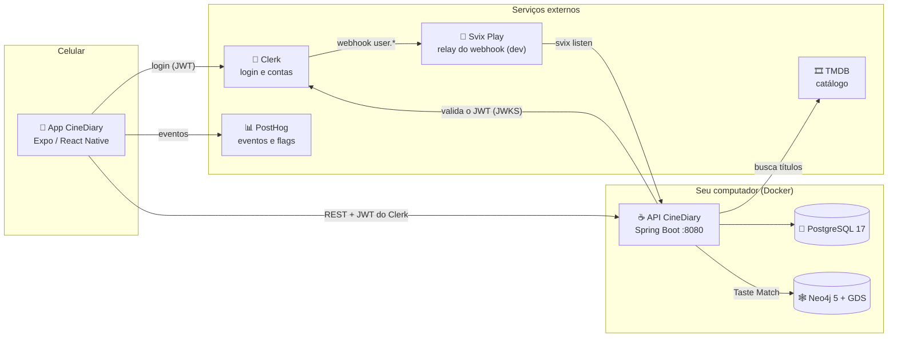
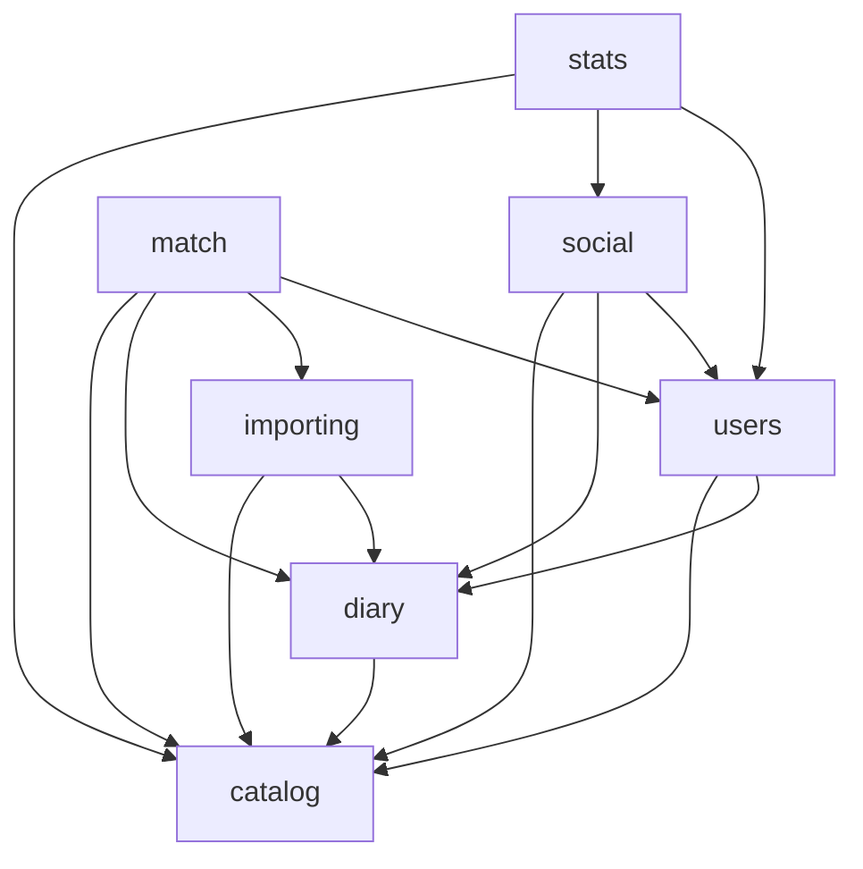
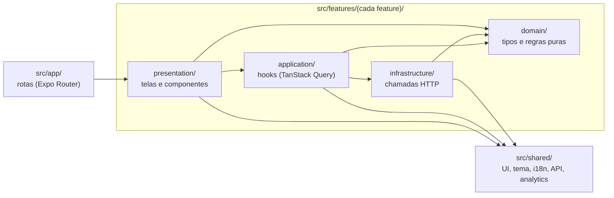

# CineDiary 🎬

Diário de filmes e séries com um lado social: você registra o que assistiu (nota, review, curtida, rever),
acompanha séries episódio por episódio, segue amigos, vê o que eles andam assistindo e descobre com quem você
tem gosto parecido (**Taste Match**).

O repositório tem duas partes que conversam por uma API REST:

| Pasta | O que é | README |
| --- | --- | --- |
| [`cinediary-mobile/`](cinediary-mobile/) | App iOS/Android em Expo (React Native + TypeScript) | [README do app](cinediary-mobile/README.md) |
| [`cinediary-backend/`](cinediary-backend/) | API em Java 25 + Spring Boot (monólito modular) | [README do backend](cinediary-backend/README.md) |
| [`docs/`](docs/) | Visão do produto, design, ADRs e o contrato da API (OpenAPI) | — |
| [`scripts/`](scripts/) | `dev.mjs`: o script por trás de `make dev` / `npm run dev` | — |

> [!IMPORTANT]
> **Antes de rodar qualquer comando, configure as variáveis de ambiente.** Sem elas, a API não sobe e o app
> não consegue fazer login. Cada README tem o passo a passo de onde pegar cada chave:
> - **Backend:** [`cinediary-backend/.env`](cinediary-backend/README.md#variáveis-de-ambiente-env): Clerk, webhook, TMDB.
> - **App:** [`cinediary-mobile/.env.local`](cinediary-mobile/README.md#variáveis-de-ambiente-envlocal): Clerk, PostHog.
>
> Os dois arquivos têm um modelo pronto (`.env.example`). Eles **nunca vão para o git**.

---

## Sumário

- [Funcionalidades](#funcionalidades)
- [Arquitetura](#arquitetura)
- [Primeira vez no projeto](#primeira-vez-no-projeto)
- [Rodando no dia a dia](#rodando-no-dia-a-dia)
- [Para quem vai mexer no código](#para-quem-vai-mexer-no-código)
- [Build do app (EAS): ainda não](#build-do-app-eas-ainda-não)
- [Problemas comuns](#problemas-comuns)
- [Documentação](#documentação)

---

## Funcionalidades

**Diário**
- Registrar um filme, uma série, uma temporada ou um episódio, com data, nota de 0,5 a 5, curtida, "rever" e review.
- Marcar uma review como spoiler: ela fica desfocada para os outros até tocar.
- "Assistido" com um toque já vira um registro de hoje.
- Progresso de série, episódio por episódio, com o status (assistindo, terminei, parei) mudando sozinho.
- Watchlist e 4 favoritos no perfil.

**Catálogo** (dados do TMDB, no idioma do aparelho: português ou inglês)
- Busca unificada de filmes e séries, com populares, em alta e buscas recentes.
- Página do título com:
  - trailer, elenco e equipe (com "Ver todos"), lançamento, produtoras, coleção e similares;
  - **nota do público**: uma nota só, juntando TMDB e CineDiary;
  - amigos que assistiram e **reviews populares**.
- Página de pessoa (filmografia) e de produtora.

**Social**
- Perfis com bio e pronomes. Seguir é livre, mas um **perfil privado** recebe pedidos para seguir.
- Busca de pessoas, seguidores e seguindo.
- Feed "Novidades dos amigos" na Início.
- **Sino**, com duas abas:
  - *Amigos*: assistiu, reviu, quer ver, seguiu, curtiu;
  - *Para você*: te seguiram, curtiram ou responderam algo seu.
- Curtir e responder reviews. Quem pode responder é configurável no perfil e em cada registro.

**Taste Match ("Juntos")**
- Convite por link: o app calcula a compatibilidade de gosto, com um grafo no Neo4j e um plano B no PostgreSQL.
- Story com slides animados.
- Watchlist compartilhada e recomendações para vocês dois.

**Outros**
- Importação do Letterboxd: você manda o ZIP exportado e confere um resumo antes de confirmar.
- Estatísticas no perfil: totais, média, gêneros e filmes por mês.
- Imagem do registro para os Stories do Instagram.
- App em português e inglês.
- Analytics e feature flags (testes A/B) pelo PostHog.

---

## Arquitetura

### Visão geral



- O **app** faz login direto no Clerk e manda o token (JWT) em cada chamada para a API.
- A **API** valida esse token sozinha, com a chave pública do Clerk, e cria o usuário na primeira chamada.
- O **webhook** do Clerk mantém nome, foto e exclusão de conta em dia. Em desenvolvimento ele chega pelo
  **Svix Play**, e o `svix listen` (que o `make dev` liga) repassa para a API local.
- O **TMDB** é consultado pela API, que guarda os títulos no PostgreSQL por 7 dias. Se o TMDB cair, a busca usa
  o que já está guardado.
- O **Neo4j** guarda o "grafo de gosto" (quem viu o quê, com que nota). A API alimenta o grafo por eventos
  (Outbox do Spring Modulith), e o Taste Match é calculado nele.

### Backend: monólito modular

A API é um único serviço dividido em **módulos** com fronteiras verificadas nos testes (Spring Modulith +
ArchUnit). Um módulo só enxerga o pacote `api` do outro, e não pode haver ciclos.



Cada módulo segue a Clean Architecture: `domain`, `application`, `infrastructure`, `presentation` e `api`.
Detalhes, tabela de módulos e onde mexer em cada coisa: [README do backend](cinediary-backend/README.md).

### App: Feature-Sliced + Clean Architecture



As setas são as únicas importações permitidas, e o `npm run lint` barra o resto.
Detalhes: [README do app](cinediary-mobile/README.md).

---

## Primeira vez no projeto

### 1. Instale as ferramentas

| Ferramenta | Para quê | Como conferir |
| --- | --- | --- |
| [Docker Desktop](https://www.docker.com/products/docker-desktop/) | Banco, Neo4j e a API empacotada | `docker --version` (e o Docker aberto) |
| [Node.js 20+](https://nodejs.org/) (LTS) | O app (Expo) e o script `dev.mjs` | `node -v` |
| [Expo Go](https://expo.dev/go) no celular | Rodar o app no celular | Loja do iPhone ou Android |
| `make` *(opcional)* | Atalhos `make dev`, `make stop`… | `make --version` (Windows sem WSL: use `npm run`) |
| JDK 25 *(só para mexer no backend)* | Rodar a API em modo dev | `java -version` |

Para só mexer no app, **não precisa de Java**: a API roda empacotada em Docker.

### 2. Configure as variáveis de ambiente

```bash
cp cinediary-backend/.env.example cinediary-backend/.env
cp cinediary-mobile/.env.example cinediary-mobile/.env.local
```

No Windows sem WSL, use `copy` no lugar de `cp`.

Depois, preencha cada arquivo seguindo o passo a passo:
- [Variáveis do backend](cinediary-backend/README.md#variáveis-de-ambiente-env)
- [Variáveis do app](cinediary-mobile/README.md#variáveis-de-ambiente-envlocal)

### 3. Instale o EAS CLI e entre na conta Expo

O app está ligado ao projeto `cinediary-app` da organização **cinediary** no [expo.dev](https://expo.dev).
Na primeira vez que o Expo abre, ele pede o login na conta Expo:

```bash
npm install --global eas-cli
eas login
```

Use a **sua** conta Expo. Ela precisa ser membro da organização `cinediary`; peça o convite a quem administra
o projeto no expo.dev.

### 4. Rode

```bash
make dev        # ou: npm run dev
```

Na primeira vez, o script instala as dependências do app (`npm install`) e empacota a API em Docker, o que
leva alguns minutos. Depois disso fica rápido.

---

## Rodando no dia a dia

Todos os comandos rodam na **pasta raiz** (`cinediary/`). Existem três jeitos de chamar, e todos fazem **a
mesma coisa**, porque chamam o mesmo script em Node (`scripts/dev.mjs`):

| O que faz | Com `make` (macOS, Linux, WSL) | Sem `make` (qualquer sistema, inclusive Windows) | Direto |
| --- | --- | --- | --- |
| Tudo: backend + Svix + Expo | `make dev` | `npm run dev` | `node scripts/dev.mjs dev` |
| Só o backend + Svix | `make back` | `npm run back` | `node scripts/dev.mjs back` |
| Só o app (Expo) | `make front` | `npm run front` | `node scripts/dev.mjs front` |
| Parar banco, Neo4j e API | `make stop` | `npm run stop` | `node scripts/dev.mjs stop` |
| Ver os logs da API | `make logs-api` | `npm run logs-api` | `node scripts/dev.mjs logs-api` |
| Reempacotar a API | `make rebuild-api` | `npm run rebuild-api` | `node scripts/dev.mjs rebuild-api` |
| Lista de comandos | `make help` | — | — |

### `make dev`: tudo de uma vez

1. **Confere o ambiente:** se o Docker está aberto, se o `.env` do backend e o `.env.local` do app estão
   preenchidos e se as dependências do app estão instaladas. Se faltar algo, para e diz o que é.
2. **Sobe o backend:** PostgreSQL, Neo4j e a **API empacotada** (Docker), e espera a API responder em
   `http://localhost:8080`.
   - Se já houver uma API rodando na 8080 (o modo dev do Spring, por exemplo), ele usa essa.
3. **Liga o Svix** em segundo plano, para o webhook do Clerk chegar na API. A saída vai para `.dev-logs/svix.log`.
4. **Abre o Expo** com o QR code. É só escanear com o Expo Go (Android) ou com a câmera (iPhone).

O `Ctrl+C` fecha o Expo e o Svix. **O banco e a API continuam rodando**, para o próximo `make dev` ser
rápido. Para desligar tudo, rode `make stop`.

> [!NOTE]
> **O `make stop` não apaga dados.** Ele remove só os containers. Os dados do PostgreSQL e do Neo4j ficam em
> volumes do Docker e voltam no próximo `make dev`. O único comando que apaga dados é o `make reset-db` do
> backend (`cd cinediary-backend && make reset-db`), e ele avisa que é destrutivo.

### `make back` + `make front`: em dois terminais

Útil quando você quer parar e reabrir o app (para instalar uma lib, por exemplo) sem derrubar o backend:

```bash
# terminal 1
make back       # banco + API e o Svix aqui, mostrando cada webhook que chega

# terminal 2
make front      # o Expo
# Ctrl+C → npx expo install alguma-lib → make front de novo
```

### Mexeu no backend?

A API em Docker é uma "foto" do código. Depois de mudar algo em `cinediary-backend/`, você tem dois caminhos:
- `make rebuild-api` reempacota e reinicia só a API.
- Para desenvolver o backend de verdade, rode a API em modo dev (`cd cinediary-backend && make run`, que precisa
  de JDK 25). O `make dev`/`make back` percebe que ela já está na 8080 e usa essa, sem subir outra.

### O app acha a API sozinho

O `.env.local` deve ficar com `EXPO_PUBLIC_API_URL=http://localhost:8080`. Em desenvolvimento, o app troca
`localhost` pelo IP do computador que roda o Metro (`src/shared/config/env.ts`). Por isso funciona mesmo
mudando de rede ou usando o hotspot do celular, **sem editar nada**. Não coloque um IP fixo: isso desliga a
troca automática.

---

## Para quem vai mexer no código

| Quero… | Leia |
| --- | --- |
| Entender o ciclo de trabalho do app (rodar, mudar, conferir, testar) | [Fluxo de trabalho do app](cinediary-mobile/README.md#fluxo-de-trabalho) |
| Ver componentes, a splash e as telas de erro sem provocar a situação | O **catálogo do Design System** dentro do app: Perfil → engrenagem → *Design System (dev)*. [Detalhes](cinediary-mobile/README.md#catálogo-do-design-system-dentro-do-app) |
| Saber onde está cada coisa no app | [Arquivos principais por feature](cinediary-mobile/README.md#arquivos-principais-por-feature) e ["Quero mudar X"](cinediary-mobile/README.md#quero-mudar-x-onde-mexo) |
| Criar ou testar uma feature flag / teste A/B no PostHog | [Analytics e feature flags](cinediary-mobile/README.md#analytics-e-feature-flags-posthog) |
| Mudar a splash ou a tela de sem conexão (trocar a versão clara ↔ terracota) | [Splash e tela de conexão](cinediary-mobile/README.md#splash-e-tela-de-conexão) |
| Criar uma feature de ponta a ponta (banco → API → app) | [Uma feature de ponta a ponta](cinediary-backend/README.md#uma-feature-de-ponta-a-ponta) |
| Saber onde está cada coisa no backend | [Arquivos principais por módulo](cinediary-backend/README.md#arquivos-principais-por-módulo) e ["Quero mudar X"](cinediary-backend/README.md#quero-mudar-x-onde-mexo) |
| Depurar a API (banco, webhook, eventos, grafo) | [Depurar](cinediary-backend/README.md#depurar) |

### CI (GitHub Actions)

Todo PR roda os checks abaixo, e o resultado aparece no próprio PR. Cada parte só trabalha quando os
arquivos dela mudam: um PR só do app pula os jobs do backend (aparecem como *skipped*, que conta como ok).

| Workflow | Checks | Roda quando muda | O que faz |
| --- | --- | --- | --- |
| [`backend.yml`](.github/workflows/backend.yml) | `backend-build`, `backend-test` | `cinediary-backend/`, `openapi-v1.yaml` | Java 25: compila e roda `./gradlew test` (Testcontainers). Se falhar, o relatório fica em **Actions → o run → Artifacts → `backend-test-report`**. |
| [`mobile.yml`](.github/workflows/mobile.yml) | `mobile-checks`, `mobile-bundle`, `mobile-deps` | `cinediary-mobile/` | Node 22: `mobile-checks` roda `npm run lint`, `npm run typecheck` e [Depcheck](https://github.com/depcheck/depcheck) (dependência sem uso ou faltando; exceções em [`.depcheckrc`](cinediary-mobile/.depcheckrc); para rodar local, `npx depcheck` dentro de `cinediary-mobile/`, com o `npm install` feito); `mobile-bundle` gera o bundle JS do Metro (`expo export`). O `mobile-deps` só roda quando o `package.json` ou o lock mudam e só avisa (sem quebrar) se algum pacote está fora da versão que o SDK do Expo espera; não é obrigatório. |
| [`contract.yml`](.github/workflows/contract.yml) | `api-contract` | `openapi-v1.yaml`, `schema.d.ts`, `cinediary-mobile/package.json` (onde fica a versão do gerador) | Regera os tipos com `npm run api:types` e falha se o `schema.d.ts` commitado estiver diferente. |
| [`commits.yml`](.github/workflows/commits.yml) | `commitlint`, `pr-title` | sempre | Todos os commits do PR e o título do PR (que vira o commit na `main` no squash merge) no [Conventional Commits](https://www.conventionalcommits.org/) (`feat(app): …`, `fix(backend): …`). Regras em [`commitlint.config.mjs`](commitlint.config.mjs). |

O [Dependabot](.github/dependabot.yml) abre PRs semanais para Gradle e npm (Expo, React e React Native ficam de
fora, porque andam junto com o SDK: atualize com `npx expo install --fix`) e mensais para as actions.

Para conferir antes de subir: `make test` em `cinediary-backend/`; `npm run typecheck`, `npm run lint` e
`npm run api:types` em `cinediary-mobile/`.

---

## Build do app (EAS): ainda não

> [!WARNING]
> **Não rode `make build-dev` por enquanto.** O development build para iPhone precisa da assinatura paga do
> **Apple Developer Program** (US$ 99 por ano), que o projeto ainda não tem. Até lá, use o **Expo Go**, que
> é o que o `make dev` e o `make front` abrem.

Para quando chegar a hora, já está tudo pronto:

| Comando | O que gera | Precisa de conta paga da Apple? |
| --- | --- | --- |
| `make build-dev` | Development build para iPhone (o "Expo Go do CineDiary", com todas as libs nativas) | Sim |
| `make build-dev SIMULATOR=1` | O mesmo, para o simulador do iOS | Não |
| `make build-dev PLATFORM=android` | Development build para Android (`.apk`) | Não |

Sem `make`: `npm run build-dev` ou `npm run build-dev -- android`. Depois de instalar o development build,
abra o app com `make front DEV_CLIENT=1` (ou `npm run front -- --dev-client`).

Os perfis de build estão em [`cinediary-mobile/eas.json`](cinediary-mobile/eas.json):
- `development` e `development-simulator`: para desenvolver;
- `preview`: para mandar alguém testar sem loja;
- `production`: para o **TestFlight** e as lojas.

Uma assinatura da Apple serve para o time todo, porque o EAS guarda os certificados na organização.

---

## Problemas comuns

| Sintoma | O que fazer |
| --- | --- |
| "O Docker não está rodando" | Abra o Docker Desktop e espere ele terminar de iniciar. |
| A API não sobe | `make logs-api` mostra o erro. O mais comum é variável vazia ou errada no `.env` do backend. |
| O app não carrega dados | Veja se a API responde: abra `http://localhost:8080/actuator/health` no navegador do computador. O celular e o computador precisam estar na mesma rede. |
| O app pede login no Expo | Rode `eas login` com uma conta que seja membro da organização `cinediary`. |
| Algo "preso" na tela logo depois de mudar o código | O Fast Refresh às vezes guarda estado antigo. Sacuda o celular e toque em **Reload**. |
| Conta nova aparece com um @ diferente do cadastrado (ex.: `cinefilo_1234`) ou sem nome e foto | O webhook do Clerk não chegou na sua API: o Svix não estava rodando ou os eventos foram para outra pessoa que rodava o `make back` ao mesmo tempo. A conta é criada mesmo assim no primeiro login, só que com um @ provisório. **Para resolver:** no app, vá em **Perfil → Editar perfil** e salve o @ certo. Confira também se o Svix está ligado (terminal do `make back` ou `.dev-logs/svix.log`). Só acontece em desenvolvimento: em produção o webhook vai direto para a API. |
| Porta 8080 ocupada | Outra API já está rodando. O `make dev` usa essa; para trocar pela do Docker, feche a outra. |

Os registros do script ficam em `.dev-logs/` (`compose.log`, `svix.log`, `npm-install.log`…).

---

## Documentação

| Documento | Conteúdo |
| --- | --- |
| [`docs/Visao Principal.md`](docs/Visao%20Principal.md) | Visão do produto |
| [`docs/Backlog.md`](docs/Backlog.md) | O que falta fazer, em formato de cards para o GitHub Projects |
| [`docs/Mvp Inicial.md`](docs/Mvp%20Inicial.md) | Escopo do MVP |
| [`docs/Arquitetura-e-Backlog-MVP.md`](docs/Arquitetura-e-Backlog-MVP.md) | Arquitetura e backlog |
| [`docs/architecture/ADRs-e-Especificacao-de-Tasks.md`](docs/architecture/ADRs-e-Especificacao-de-Tasks.md) | Decisões de arquitetura (ADRs) e a tabela de eventos de analytics |
| [`docs/architecture/Clean-Architecture-v2-Blueprint.md`](docs/architecture/Clean-Architecture-v2-Blueprint.md) | O blueprint de camadas do backend e do app |
| [`docs/architecture/openapi-v1.yaml`](docs/architecture/openapi-v1.yaml) | Contrato da API (de onde saem os tipos do app) |
| [`docs/design/UX-01-Design-System.md`](docs/design/UX-01-Design-System.md) | Design System (cores, tipografia, componentes) |
| [`docs/design/UX-02-a-05-Fluxos-e-Telas.md`](docs/design/UX-02-a-05-Fluxos-e-Telas.md) | Fluxos e telas |
| [`docs/guides/instagram-stories.md`](docs/guides/instagram-stories.md) | Compartilhar nos Stories |
| [`docs/design/brand/`](docs/design/brand/README.md) | Ícones e splash (arquivos-fonte da marca) |
