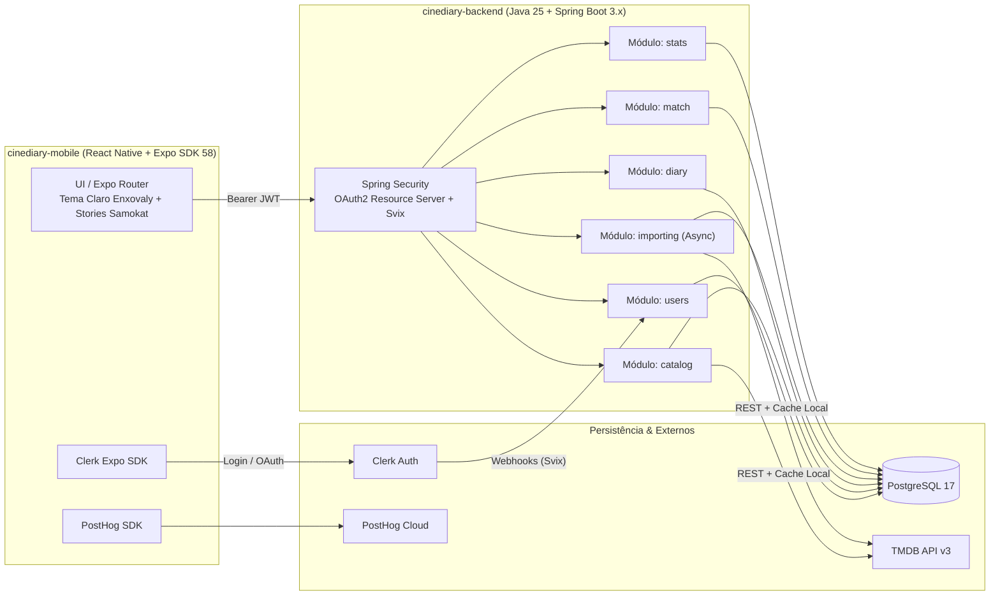

# CineDiary — Arquitetura Técnica, Modelagem e Backlog de Tasks (MVP)

> **Versão:** 1.0 · **Data:** 13/11/2026  
> **Responsável:** Architect Senior  
> **Status das Decisões do MVP:** Fechadas e alinhadas

---

## 1. Decisões de Produto e Arquitetura Consolidadas

Todas as pendências da Seção 9 do documento de MVP foram definidas:

| Item | Decisão Oficial para o MVP |
| --- | --- |
| **Fórmula do Taste Match (SQL)** | **50% Notas** (proximidade de avaliações nos títulos em comum) + **30% Gêneros** (interseção ponderada entre onboarding e histórico) + **20% Favoritos/Likes** (afinidade em títulos curtidos/favoritos). Quando há `< 3` títulos em comum, os pesos de Notas redistribuem proporcionalmente para Gêneros (65%) e Favoritos/Sinais de Onboarding (35%). |
| **Mínimo de Dados e Cold Start** | **Mínimo de 10 títulos por pessoa** (garantido já no passo de filmes conhecidos do onboarding cinematográfico). Quando a dupla tem `< 3` títulos assistidos em comum, o Match Story ativa o **Modo Descoberta**, destacando gêneros em comum e a seção *"O que um ama e o outro ainda não viu"*. |
| **Avaliação de Séries** | Nota de `0.5` a `5.0` estrelas aplicada **apenas à série geral** no MVP. O acompanhamento de progresso (marcar temporadas e episódios assistidos, status `WATCHING`, `COMPLETED`, `DROPPED`) permanece completo no MVP. Notas por temporada ficam para o pós-MVP. |
| **Idioma e Mercado Inicial** | **100% Português (PT-BR)** na interface mobile e integração com o TMDB (`language=pt-BR`, região `BR`). |
| **Estrutura de Pastas e Repositórios** | `/Users/eduardodantas/Downloads/openbot/cinediary/` contendo `cinediary-backend`, `cinediary-mobile` e `docs/` (com espelho sincronizado em `/Users/eduardodantas/OpenBot/Shared/cinediary/`). |

---

## 2. Arquitetura do Sistema (MVP)



### 2.1. Estrutura de Pacotes do Backend (`cinediary-backend`)

Monólito modular em **Java 25 + Spring Boot + Gradle Kotlin DSL + Flyway**:

```text
cinediary-backend/
├── build.gradle.kts
├── settings.gradle.kts
├── Makefile
├── docker-compose.yml
└── src/main/
    ├── java/com/cinediary/api/
    │   ├── shared/           # Config, Security (JWT/Clerk), Exception Handler, OpenAPI, Paginação
    │   ├── users/            # Usuários, Perfil, Privacidade, Onboarding Signals, Clerk Webhook (Svix)
    │   ├── catalog/          # Cliente TMDB, Cache PostgreSQL de Filmes/Séries/Temporadas/Gêneros
    │   ├── diary/            # DiaryEntries (rewatch), Ratings, Likes, Reviews, Watchlist, SeriesProgress
    │   ├── importing/        # Upload ZIP Letterboxd, Job Assíncrono, Parser CSV, Reconciliação TMDB
    │   ├── match/            # Convites, Cálculo SQL Explicável, Match Story DTO, Shared Watchlist
    │   └── stats/            # Agregações SQL do perfil (totais, nota média, gêneros, filmes/mês)
    └── resources/
        ├── application.yml
        └── db/migration/     # Scripts Flyway V1__init.sql ...
```

### 2.2. Estrutura de Pastas do Mobile (`cinediary-mobile`)

Aplicativo em **React Native + Expo + TypeScript + Expo Router**:

```text
cinediary-mobile/
├── app/                      # Rotas Expo Router
│   ├── (auth)/               # Login / Cadastro (Clerk) + Onboarding (3 passos)
│   ├── (tabs)/               # Home/Diário, Busca, Taste Match, Perfil
│   ├── title/[id].tsx        # Página do Filme ou Série (progresso de temporadas/episódios)
│   ├── match/[id]/           # Sala do Match, Story 9:16 e Watchlist Compartilhada
│   └── import/               # Fluxo de importação do ZIP do Letterboxd
├── src/
│   ├── components/           # Design System ( Cards, Poster, StarRating, StoryCanvas )
│   ├── features/             # Módulos de domínio (auth, onboarding, catalog, diary, importing, match, stats)
│   ├── services/             # Cliente HTTP tipado (gerado via OpenAPI) + interceptors JWT
│   ├── stores/               # Estado global enxuto (Zustand + TanStack Query)
│   ├── theme/                # Tokens visuais (Off-white/Creme, Terracota, Pipoca, Sálvia, Rosa Queimado)
│   └── types/                # Tipos gerados do OpenAPI
```

---

## 3. Modelagem de Dados (PostgreSQL — MVP)

```mermaid
erDiagram
    USERS ||--o{ USER_GENRE_PREFERENCES : has
    USERS ||--o{ USER_TITLE_SIGNALS : has
    USERS ||--o{ DIARY_ENTRIES : logs
    USERS ||--o{ USER_TITLE_STATES : maintains
    USERS ||--o{ SERIES_EPISODE_LOGS : watches
    USERS ||--o{ IMPORT_JOBS : runs
    CATALOG_TITLES ||--o{ DIARY_ENTRIES : referenced_in
    CATALOG_TITLES ||--o{ USER_TITLE_STATES : state_of
    CATALOG_TITLES ||--o{ CATALOG_SEASONS : has
    CATALOG_SEASONS ||--o{ CATALOG_EPISODES : contains
    TASTE_MATCHES ||--o{ MATCH_SHARED_WATCHLIST : shares

    USERS {
        uuid id PK
        varchar clerk_id UK
        varchar username UK
        varchar display_name
        varchar avatar_url
        boolean is_private
        boolean onboarding_completed
        timestamptz created_at
    }

    WEBHOOK_EVENTS {
        varchar svix_id PK
        varchar event_type
        timestamptz processed_at
    }

    CATALOG_TITLES {
        bigint id PK
        bigint tmdb_id
        varchar media_type "MOVIE | SERIES"
        varchar title_pt
        varchar original_title
        smallint release_year
        varchar poster_path
        varchar backdrop_path
        text overview_pt
        integer runtime_minutes
        integer number_of_seasons
        integer number_of_episodes
        jsonb genres_json
        timestamptz synced_at
    }

    USER_GENRE_PREFERENCES {
        uuid user_id PK, FK
        integer tmdb_genre_id PK
        varchar source "ONBOARDING | INFERRED"
    }

    USER_TITLE_SIGNALS {
        uuid user_id PK, FK
        bigint title_id PK, FK
        varchar signal_type "ONBOARDING_SEEN | ONBOARDING_FAVORITE"
        timestamptz created_at
    }

    USER_TITLE_STATES {
        uuid user_id PK, FK
        bigint title_id PK, FK
        numeric rating "0.5 to 5.0 (step 0.5)"
        boolean liked
        boolean is_favorite
        boolean in_watchlist
        varchar series_status "WATCHING | COMPLETED | DROPPED | NULL"
        timestamptz first_watched_at
        timestamptz updated_at
    }

    DIARY_ENTRIES {
        uuid id PK
        uuid user_id FK
        bigint title_id FK
        date watched_date
        numeric rating_snapshot "0.5 to 5.0"
        boolean liked_snapshot
        boolean is_rewatch
        text review_text
        varchar import_hash UK "Idempotência na importação"
        timestamptz created_at
    }

    SERIES_EPISODE_LOGS {
        uuid user_id PK, FK
        bigint title_id PK, FK
        smallint season_number PK
        smallint episode_number PK
        timestamptz watched_at
    }

    IMPORT_JOBS {
        uuid id PK
        uuid user_id FK
        varchar provider "LETTERBOXD"
        varchar status "PARSING | AWAITING_CONFIRMATION | APPLYING | COMPLETED | FAILED"
        integer total_items_read
        integer matched_items_count
        integer unmatched_items_count
        jsonb preview_summary_json
        jsonb staged_payload_json
        timestamptz created_at
        timestamptz completed_at
    }

    TASTE_MATCHES {
        uuid id PK
        varchar invite_code UK
        uuid creator_user_id FK
        uuid partner_user_id FK
        varchar status "PENDING | ACTIVE | ARCHIVED"
        smallint compatibility_score "0 to 100"
        jsonb breakdown_json "Explicação e dados do Story"
        timestamptz last_calculated_at
        timestamptz created_at
    }

    MATCH_SHARED_WATCHLIST {
        uuid match_id PK, FK
        bigint title_id PK, FK
        uuid added_by_user_id FK
        timestamptz added_at
    }
```



### Destaques da Modelagem
1. **Separação entre Estado Atual (`USER_TITLE_STATES`), Sinais de Onboarding (`USER_TITLE_SIGNALS`) e Diário (`DIARY_ENTRIES`):**
   - Cumpre a regra de negócio de independência entre ações (curtir sem dar nota, adicionar à watchlist, dar nota sem criar review) e permite múltiplos registros com datas diferentes (*rewatch*) em `DIARY_ENTRIES`.
   - Cumpre a regra do checkbox desmarcado no onboarding: se desmarcado, grava apenas em `USER_TITLE_SIGNALS` (alimentando o Taste Match sem sujar o diário); se marcado, grava também em `USER_TITLE_STATES` / `DIARY_ENTRIES`.
2. **Idempotência de Webhooks e Importação:**
   - `WEBHOOK_EVENTS (svix_id)` garante que reenvios do Clerk nunca dupliquem operações.
   - `DIARY_ENTRIES.import_hash` (`SHA-256(user_id + tmdb_id + watched_date + provider)`) + `ON CONFLICT DO NOTHING` garante que importar o mesmo ZIP duas vezes não duplique nenhum registro.

---

## 4. Especificação da Fórmula SQL do Taste Match

O cálculo em `ModMatch` gera um score de `0` a `100` totalmente explicável:

1. **Sinal 1 — Proximidade de Notas ($S_{\text{notas}}$, peso 50%):**
   - Para todos os títulos $i \in C$ avaliados por ambos os usuários ($A$ e $B$):
     $$s_i = 1 - \frac{|r_{A,i} - r_{B,i}|}{4.5}$$
   - $S_{\text{notas}} = \frac{1}{|C|} \sum_{i \in C} s_i \times 100$.
2. **Sinal 2 — Afinidade de Gêneros ($S_{\text{generos}}$, peso 30%):**
   - Conjunto de gêneros de cada usuário (união de `USER_GENRE_PREFERENCES` + top gêneros com nota $\ge 3.5$ ou marcados no onboarding).
   - Coeficiente de Jaccard ponderado pela frequência:
     $$S_{\text{generos}} = \frac{|G_A \cap G_B|}{|G_A \cup G_B|} \times 100$$
3. **Sinal 3 — Favoritos, Curtidas e Títulos Vistos ($S_{\text{afeto}}$, peso 20%):**
   - Proporção de títulos que ambos curtiram/favoritaram ou marcaram com nota $\ge 4.0$ (incluindo sinais do onboarding).
4. **Regra de Cold Start (`< 3` títulos avaliados em comum):**
   - Ativa flag `discovery_mode = true` no JSON do Story.
   - Pesos ajustados para `65% Gêneros + 35% Sinais de Onboarding/Favoritos`.
   - O Story exibe o card especial *"Vocês têm muito a apresentar um ao outro"* com os melhores filmes de $A$ que $B$ ainda não viu e vice-versa.

---

## 5. Contratos Principais da API REST (OpenAPI v1)

| Módulo | Método e Rota | Descrição |
| --- | --- | --- |
| `users` | `POST /api/v1/webhooks/clerk` | Recebe eventos `user.created`, `user.updated`, `user.deleted` validados via Svix |
| `users` | `GET /api/v1/me` · `PATCH /api/v1/me` | Retorna/atualiza perfil, `@username`, `isPrivate` e favoritos |
| `users` | `POST /api/v1/me/onboarding` | Salva gêneros, filmes conhecidos e flag `addToHistory` (default `false`) |
| `catalog` | `GET /api/v1/catalog/search?q=&type=` | Busca unificada (filmes e séries) em PT-BR com cache local no PostgreSQL |
| `catalog` | `GET /api/v1/catalog/{mediaType}/{tmdbId}` | Detalhes do filme ou série (incluindo temporadas e episódios para séries) |
| `diary` | `PUT /api/v1/titles/{titleId}/state` | Ação rápida em 1 toque (watched, rating 0.5–5.0, liked, watchlist, seriesStatus) |
| `diary` | `POST /api/v1/diary/entries` | Cria entrada no diário (suporta rewatch com data específica e review textual) |
| `diary` | `PUT /api/v1/series/{titleId}/episodes` | Marca episódio ou temporada inteira como assistida em lote |
| `importing` | `POST /api/v1/imports/letterboxd` | Faz upload do `.zip`, inicia job assíncrono de parsing e matching com TMDB |
| `importing` | `GET /api/v1/imports/{jobId}` | Consulta status e resumo (`matched`, `unmatched`, preview) |
| `importing` | `POST /api/v1/imports/{jobId}/confirm` | Confirma e persiste os itens de forma idempotente |
| `stats` | `GET /api/v1/users/{username}/stats` | Totais de filmes/séries, nota média, gêneros mais vistos e filmes por mês |
| `match` | `POST /api/v1/matches` | Cria Taste Match pendente e retorna `inviteCode` e deep link |
| `match` | `POST /api/v1/matches/{inviteCode}/accept` | Aceita convite, dispara cálculo SQL e ativa o Match automaticamente |
| `match` | `GET /api/v1/matches/{matchId}/story` | Retorna payload estruturado das telas do Match Story + explicação do score |
| `match` | `GET / POST / DELETE /api/v1/matches/{matchId}/watchlist` | Gerencia a watchlist compartilhada da dupla |

---

## 6. Backlog de Tasks do MVP (Divisão por Especialista)

### Fase 1 — UX/UI Design (`Designer UX/UI Senior`)
- **UX-01 · Design System "Enxovaly + Samokat":** Definir paleta de cores (fundo creme/off-white `#FAF6F0`, terracota, amarelo-pipoca, verde-sálvia, rosa queimado), tipografia (serifada com itálico nos títulos + sans arredondada), espaçamentos e componentes base (PosterCard, StarRating meia-estrela, BottomTab).
- **UX-02 · Fluxo de Conta e Onboarding Cinematográfico (≤ 3 telas, < 1 min):** Tela de boas-vindas/login, seleção de gêneros, grade de filmes populares e checkbox *"Adicionar ao meu histórico"* desmarcado por padrão.
- **UX-03 · Busca, Registro em ≤ 3 Toques e Progresso de Séries:** Quick-action sheet para marcar assistido/nota/like/watchlist em até 3 toques a partir da busca, tela de detalhes de série com barras de progresso por temporada e check rápido de episódios.
- **UX-04 · Fluxo de Importação do Letterboxd:** Tela de instruções + seleção do ZIP, estado de processamento assíncrono e tela de resumo antes da confirmação.
- **UX-05 · Taste Match, Match Story (9:16) e Watchlist Compartilhada:** Estado *"Aguardando seu amigo"*, sequência narrativa de Stories (Score explicável, Gêneros, Ambos Amam, Discordâncias / Modo Descoberta, Recomendações), template de exportação PNG 9:16 e aba de Watchlist Compartilhada.

### Fase 2 — Fundação (`Programador Backend Senior` & `Programador FrontEnd Mobile Senior`)
- **BE-01 · Bootstrap do Backend e Infra Local:** Criar projeto `cinediary-backend` (Java 25, Spring Boot 3.x, Gradle Kotlin DSL), `docker-compose.yml` (PostgreSQL 17), `Makefile` padronizado, Flyway com migration `V1__init_mvp_schema.sql` e Springdoc OpenAPI.
- **BE-02 · Autenticação Clerk + Webhook Svix Idempotente:** Configurar Spring Security OAuth2 Resource Server validando JWT do Clerk e endpoint `/api/v1/webhooks/clerk` validado com Svix e deduplicação em `webhook_events`.
- **BE-03 · Módulo `catalog` (TMDB Proxy + Cache PostgreSQL):** Implementar cliente TMDB (`language=pt-BR`), busca unificada de filmes/séries, consulta de temporadas/episódios e cache persistente em `catalog_titles` para evitar rate-limit e unificar IDs.
- **FE-01 · Bootstrap Mobile + Design System Base:** Inicializar `cinediary-mobile` (Expo SDK 58, TypeScript, Expo Router), configurar tema claro Enxovaly, fontes e componentes base reutilizáveis.
- **FE-02 · Integração Clerk, PostHog e Cliente API:** Configurar login/cadastro (E-mail, Google, Apple) via `@clerk/clerk-expo`, cliente HTTP com injeção de JWT, geração de tipos OpenAPI e wrapper de eventos do PostHog.

### Fase 3 — Diário, Séries, Perfil e Importação (`Backend` & `Mobile`)
- **BE-04 · Módulo `users` (Onboarding e Perfil):** Endpoints de perfil público/privado, favoritos e gravação do onboarding diferenciando `user_title_signals` (checkbox desmarcado) de `diary_entries` (checkbox marcado).
- **BE-05 · Módulo `diary` e `stats`:** Endpoints de avaliação independente (0.5–5.0), curtida, watchlist, entradas no diário com suporte a rewatch, marcação de episódios/temporadas de séries e agregações SQL de estatísticas gratuitas.
- **BE-06 · Módulo `importing` (Letterboxd ZIP Assíncrono e Idempotente):** Upload seguro de ZIP (`watched.csv`, `ratings.csv`, `diary.csv`, `reviews.csv`, `watchlist.csv`), job assíncrono de reconciliação com TMDB (meta: 1.000 filmes < 2 min), resumo pré-confirmação e persistência idempotente via `import_hash`.
- **FE-03 · Telas de Onboarding Cinematográfico:** Implementar as 3 telas de onboarding com suporte a deep link de convite pendente do Taste Match.
- **FE-04 · Telas de Busca, Diário (≤ 3 toques) e Séries:** Implementar busca unificada, modal de registro rápido, página de filme/série com controle de temporadas/episódios e Watchlist.
- **FE-05 · Telas de Perfil, Estatísticas e Importação Letterboxd:** Implementar perfil (favoritos, últimos registros, gráficos de gêneros e filmes/mês) e fluxo de envio/resumo/confirmação do ZIP do Letterboxd.

### Fase 4 — Taste Match (`Backend` & `Mobile`)
- **BE-07 · Módulo `match` (Convites, Motor SQL e Watchlist Compartilhada):** Criar geração de convite, aceite automático pós-onboarding, motor SQL explicável (50% notas / 30% gêneros / 20% favoritos + Modo Descoberta se `< 3` em comum), recálculo automático ao registrar novo título e CRUD da watchlist compartilhada.
- **FE-06 · Experiência Taste Match, Match Story 9:16 e Compartilhamento:** Implementar criação/convite, estado de espera, visualizador animado de Stories (estética Samokat), captura/compartilhamento de cada slide como imagem 9:16 (`react-native-view-shot` + `expo-sharing`) e tela de Watchlist Compartilhada.
