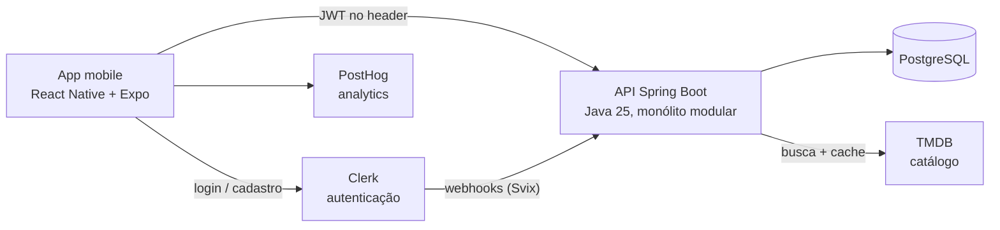

# CineDiary — Documento de MVP

> **Versão:** 1.0 · **Data:** 13/11/2026
> Documento derivado da [Visão geral do produto](./visao-geral-do-produto.md). A visão continua sendo a referência de longo prazo; este documento define **o que vamos construir agora**.

---

## 1. Resumo do MVP

O MVP do CineDiary é um **diário de filmes e séries**, com **importação do Letterboxd** e um **Taste Match** no estilo Spotify Blend, num app mobile com visual claro e acolhedor. Todo o resto da visão (feed, Movie Blend, IA, Wrapped, monetização) fica para depois de validarmos esse núcleo.

**Para quem:** usuários de Letterboxd que também assistem séries e sentem falta de um lugar único para registrar tudo e comparar gostos com amigos.

**Hipótese central:** se a pessoa consegue trazer o histórico dela em 1 minuto e registrar filmes e séries no mesmo lugar, ela continua registrando. E se o resultado do Taste Match for bonito o bastante, ela compartilha e convida amigos.

**O MVP existe para responder a três perguntas:**

1. As pessoas importam o histórico e continuam registrando depois de 30 dias?
2. As pessoas criam um Match e convidam alguém?
3. Quem recebe o convite cria conta e chega até o resultado?

---

## 2. Problema e evidências

As dores que motivam o MVP aparecem em reviews e na imprensa, não só na nossa experiência:

- **Séries no Letterboxd:** é o pedido mais repetido nas reviews. O Letterboxd anunciou séries em janeiro de 2024 e, até nov/2026, não lançou ([análise de reviews](https://punchamoorthee.substack.com/p/a-deep-dive-into-letterboxd), [JoBlo](https://joblo.com/?p=739438)).
- **Social limitado:** não dá para responder diretamente a um comentário nem marcar pessoas nas respostas ([newsletter](https://henrytcasey.beehiiv.com/p/021-we-can-all-learn-from-letterboxd-s-flaws)).
- **Estatísticas pagas:** as estatísticas detalhadas ficam no plano Pro ([Moviebase](https://moviebase.app/pl/resources/best-letterboxd-alternatives-for-android)).
- **Comparar gostos com amigos:** não encontramos um "Spotify Blend de filmes" consolidado. Os apps de swipe resolvem outro problema (decidir o que ver na hora).

### Concorrentes

| Concorrente | O que resolve | O que falta |
| --- | --- | --- |
| Letterboxd | Diário e comunidade de filmes | Séries; compatibilidade com amigos |
| Serializd, TV Time, Trakt | Acompanhamento de séries | Comunidade forte de filmes; compatibilidade |
| [Filmow](https://filmow.com/o-que-e-filmow/) | Rede brasileira de filmes e séries | Compatibilidade no estilo Blend |
| [Cinetic](https://www.producthunt.com/p/cinetic-what-to-watch/cinetic-what-to-watch) | Diz ter um "Blend" de compatibilidade | **A testar:** ver se existe e se é bom |
| Keekup | Rede social com recomendações para grupo | Testado: não tem Match com porcentagem |
| Apps de swipe (NxtUp, Wecide…) | Decidir o que ver na hora | Não guardam histórico; muitos foram descontinuados |

**Janela de oportunidade:** em abril de 2026 foi noticiado que a Tiny procura comprador para sua fatia de 60% do Letterboxd ([fonte](https://wikwiand-revamp.pages.dev/en/Letterboxd)). Incerteza costuma abrir espaço para alternativas.

---

## 3. Escopo do MVP

O MVP tem cinco blocos. Cada um tem critérios de aceite: um bloco só é considerado pronto quando todos os critérios passam.

### 3.1. Conta e onboarding

Cadastro e login com Clerk, perfil básico (nome, @, foto) e o onboarding cinematográfico (gêneros + filmes conhecidos), porque é ele que alimenta o Match.

- [ ] Criar conta e entrar com e-mail ou Google/Apple
- [ ] Onboarding com no máximo 3 telas, concluído em menos de 1 minuto
- [ ] O checkbox "adicionar ao meu histórico" começa desmarcado; desmarcado, as escolhas viram apenas sinais de preferência
- [ ] Um usuário criado no Clerk aparece no PostgreSQL via webhook, sem duplicar se o evento chegar duas vezes

### 3.2. Diário de filmes e séries

O núcleo do produto: busca no catálogo do TMDB e registro rápido.

- [ ] Buscar filme ou série pelo nome
- [ ] Marcar como assistido, dar nota (0,5 a 5 estrelas), curtir e escrever review, cada ação independente das outras
- [ ] Registrar a mesma produção mais de uma vez (rewatch), com datas diferentes
- [ ] Watchlist: adicionar e remover
- [ ] Séries: marcar episódios e temporadas como assistidos, ver o progresso, marcar como concluída ou abandonada
- [ ] Registrar um filme em até 3 toques a partir da busca

### 3.3. Importação do Letterboxd

Entra no MVP porque o Match depende de histórico. Sem ela, o primeiro Match sai raso.

- [ ] Enviar o ZIP exportado pelo Letterboxd
- [ ] Importar assistidos, datas, notas, curtidas, reviews e watchlist
- [ ] Mostrar um resumo antes de confirmar (quantos itens foram lidos e quantos não foram encontrados no TMDB)
- [ ] Importar o mesmo arquivo duas vezes não duplica nada
- [ ] Um histórico de 1.000 filmes é importado em menos de 2 minutos

### 3.4. Perfil e estatísticas básicas

- [ ] Perfil com favoritos, últimos registros e total de filmes e de séries
- [ ] Estatísticas gratuitas: gêneros mais vistos, nota média, filmes por mês
- [ ] Perfil público ou privado

### 3.5. Taste Match (o diferencial)

Compatibilidade entre duas pessoas, apresentada em Stories no estilo Spotify Blend.

- [ ] Criar um Match e gerar um link de convite
- [ ] Enquanto o convite não é aceito, o Match aparece como "Aguardando seu amigo"
- [ ] Convidado sem conta: cadastro → onboarding → o Match começa sozinho
- [ ] O Story mostra a porcentagem, os gêneros em comum, os filmes que os dois amam, onde discordam e recomendações para verem juntos
- [ ] Cada tela do Story pode ser compartilhada como imagem 9:16
- [ ] A porcentagem é explicável (dá para dizer de onde veio cada parte do número)
- [ ] O Match é recalculado quando um dos dois registra algo novo
- [ ] Watchlist compartilhada do Match: é o que faz a pessoa voltar depois do primeiro Story

---

## 4. Fora do MVP

Tudo abaixo continua na visão, mas só entra depois que o MVP responder às três perguntas. O critério foi: se não ajuda a validar o diário ou o Match, fica para depois.

| Funcionalidade | Por que fica para depois | Quando reavaliar |
| --- | --- | --- |
| Feed social, seguir, curtir, comentar | Um feed sem amigos fica vazio; o Match já testa a parte social | Quando houver uma base de usuários conectados entre si |
| Movie Blend (grupo) | É uma extensão do Match; primeiro validamos com duas pessoas | Se o Match for criado e compartilhado com frequência |
| Marcação de amigos | Depende da parte social estar funcionando | Junto com o feed |
| Listas personalizadas | É bom ter, mas não testa a hipótese | Logo depois do MVP (é barata) |
| Conversational Discovery (IA) | Custo e complexidade altos; não é a dor principal | Depois do Blend |
| Cinematic DNA e Wrapped | O Wrapped precisa de um ano de dados | Wrapped: dezembro do primeiro ano com usuários |
| Notificações contextuais | Dependem do Match e de dados acumulados | Depois de validar o Match |
| Neo4j + GDS | Com poucos usuários, SQL resolve a compatibilidade | Quando o SQL ficar lento ou limitado |
| Premium, anúncios, RevenueCat | Cobrar antes de ter usuários ativos atrapalha o crescimento | Depois de comprovar retenção |
| Versão Web | Mobile primeiro | Depois do lançamento público |
| Outros provedores de importação | O Letterboxd cobre o público inicial | Sob demanda |

---

## 5. Identidade visual e tom

Referência principal: **[Enxovaly](https://enxovaly.com/)**, uma vibe calma, suave e acolhedora. O **Samokat** fica restrito aos momentos especiais (Stories do Match).

- **Tema claro**, com fundo creme/off-white (lembra papel e diário), ao contrário do padrão escuro dos apps de cinema.
- **Cores de destaque suaves e "empoeiradas"**: terracota, amarelo-pipoca, verde-sálvia, rosa queimado. Nada saturado.
- **Os cartazes são a cor principal da tela**: a interface fica neutra para eles aparecerem.
- **Tipografia:** uma serifada com itálico nos títulos ("Seu ano em *filmes*") e uma sem-serifa arredondada no resto.
- **Componentes arredondados**, cards e espaçamento generoso.
- **Tom de texto carinhoso e conversado:** "Que tal registrar o que você viu ontem?" em vez de "Log your film".
- **Stories do Match:** o único lugar com mais cor e animação, porque é o "momento festa".

---

## 6. Arquitetura enxuta do MVP

O MVP usa só o necessário da arquitetura da visão: **app → API Spring Boot → PostgreSQL**, mais Clerk, TMDB e PostHog. Sem Neo4j, sem Outbox, sem Kafka e sem IA por enquanto.

**Módulos do backend no MVP:**

| Módulo | Responsabilidade |
| --- | --- |
| `users` | Sincronizar usuários via webhook do Clerk (idempotente), perfil, privacidade |
| `catalog` | Integração com o TMDB, cache local dos títulos usados |
| `diary` | Registros, notas, curtidas, reviews, watchlist, progresso de séries |
| `importing` | Upload do ZIP, parsing, matching com o TMDB, resumo, confirmação idempotente |
| `match` | Convites, cálculo de compatibilidade, dados do Story, watchlist compartilhada |
| `stats` | Estatísticas básicas do perfil |

**Decisões tomadas para o MVP (e o porquê):**

- **Todas as chamadas ao TMDB passam pelo backend.** Assim protegemos a chave da API, temos um cache único e o mesmo ID de título em todo o sistema. Isso é importante para a importação e para o Match.
- **A compatibilidade é calculada em SQL.** Com poucos usuários, comparar notas e gêneros de duas pessoas é uma consulta simples. Fazer primeiro em SQL também ajuda a entender o problema antes de modelar o grafo.
- **A importação roda de forma assíncrona** (job em background + status consultável pelo app), porque um ZIP grande não cabe numa requisição síncrona.
- **O contrato da API é documentado com OpenAPI** desde o primeiro endpoint, para o mobile poder gerar os tipos TypeScript.

---

## 7. Métricas de sucesso e critérios de decisão

As métricas são acompanhadas no PostHog durante o beta fechado. As metas são **hipóteses iniciais**: vamos ajustá-las depois das primeiras semanas.

| Pergunta | Métrica | Meta inicial |
| --- | --- | --- |
| As pessoas continuam registrando? | % de usuários que registram algo na semana 4 | ≥ 30% |
| A importação funciona? | % de importações concluídas sem erro | ≥ 90% |
| O Match gera convites? | % de usuários que criam pelo menos 1 Match | ≥ 40% |
| O convite converte? | % de convidados que chegam ao Story | ≥ 50% |
| O Match é compartilhado? | % de Stories compartilhados fora do app | ≥ 20% |

**Eventos mínimos no PostHog:** `user_signed_up`, `onboarding_completed`, `title_logged`, `import_started`, `import_completed`, `match_created`, `match_invite_accepted`, `match_story_viewed`, `match_story_shared`.

**Como decidimos depois do beta:**

- **Retenção e Match bons** → seguimos para o feed social e o Movie Blend.
- **Retenção boa, Match fraco** → o diário é o produto; investimos em séries e estatísticas e repensamos o Match.
- **Retenção fraca** → antes de adicionar qualquer coisa, conversamos com quem parou de usar para entender o motivo.

---

## 8. Plano de execução por fases

Cada fase termina com um **portão** (gate): só avançamos quando o critério dele é atendido.

```mermaid
flowchart LR
    F0["Fase 0<br/>Discovery"] --> G0{{"10+ entrevistas<br/>feitas"}}
    G0 --> F1["Fase 1<br/>Design"] --> G1{{"Protótipo testado<br/>com 5 pessoas"}}
    G1 --> F2["Fase 2<br/>Fundação"] --> G2{{"Login + busca<br/>ponta a ponta"}}
    G2 --> F3["Fase 3<br/>Diário + importação"] --> G3{{"Nós dois usando<br/>no dia a dia"}}
    G3 --> F4["Fase 4<br/>Taste Match"] --> G4{{"Match entre<br/>nós dois funciona"}}
    G4 --> F5["Fase 5<br/>Beta fechado"] --> G5{{"Decisão com<br/>as métricas"}}
```

### Fase 0 — Discovery
- [ ] Testar o Cinetic (o Blend existe e é bom?) e anotar como os concorrentes resolvem o usuário sem histórico
- [ ] Entrevistar 10 a 15 usuários de Letterboxd que não sejam amigos próximos
- [ ] Perguntar sobre comportamento: como registram séries hoje, se usam o Spotify Blend e se ainda abrem
- [ ] Revisar este documento com o que aprendermos

### Fase 1 — Design
- [ ] Moodboard e design system básico (cores, tipografia, componentes)
- [ ] Fluxos: onboarding, registro, importação, criação e aceite do Match
- [ ] Protótipo do Match Story no Figma, testado com 5 pessoas

### Fase 2 — Fundação
- [ ] Repositórios, Expo, Spring Boot (Java 25, Gradle Kotlin DSL), Makefile, Docker Compose
- [ ] CI básico (build + testes) e OpenAPI
- [ ] Clerk no app e Resource Server no backend; webhook com Svix e idempotência
- [ ] Integração com o TMDB pelo backend, com cache

### Fase 3 — Diário + importação
- [ ] Registro de filmes e séries, notas, reviews, watchlist, progresso de séries
- [ ] Perfil e estatísticas básicas
- [ ] Importação do Letterboxd (assíncrona e idempotente)

### Fase 4 — Taste Match
- [ ] Convites, onboarding do convidado e início automático
- [ ] Cálculo de compatibilidade em SQL, explicável
- [ ] Match Story e compartilhamento em imagem 9:16
- [ ] Watchlist compartilhada

### Fase 5 — Beta fechado
- [ ] TestFlight e teste interno do Google Play com 30 a 50 pessoas
- [ ] Eventos do PostHog validados
- [ ] Revisão de privacidade e LGPD
- [ ] Decisão de próximo passo com base nas métricas (seção 7)

---

## 9. Decisões pendentes e riscos

### Decisões pendentes

- [ ] Fórmula da compatibilidade: quais sinais entram (notas, gêneros, títulos em comum) e com que pesos?
- [ ] Qual o mínimo de dados para um Match ter um resultado decente? (Ex.: 20 títulos avaliados)
- [ ] Como mostrar um Match com pouco histórico sem decepcionar?
- [ ] Notas por temporada de série entram no MVP ou depois?
- [ ] Lançamento focado no Brasil ou global (idioma do app e das reviews)?
- [ ] Nome e identidade visual definitivos
- [ ] Nomes dos repositórios e onde fica a documentação

### Riscos

| Risco | Impacto | Mitigação |
| --- | --- | --- |
| Escopo cresce e o MVP nunca é lançado | Alto | Este documento é o limite; ideia nova vai para a seção 4 |
| Match fraco com pouco histórico (cold start) | Alto | Importação no MVP, onboarding com filmes conhecidos, mínimo de dados definido |
| Retenção baixa (filme se assiste pouco) | Alto | Séries no diário (uso mais frequente) e watchlist compartilhada no Match |
| Formato do export do Letterboxd mudar | Médio | Parser isolado no módulo `importing`, com testes usando arquivos reais |
| Limites ou termos de uso do TMDB | Médio | Cache no backend e atribuição conforme os termos |
| Tempo limitado (projeto paralelo de duas pessoas) | Médio | Fases pequenas com gates; GitHub Projects atualizado semanalmente |
