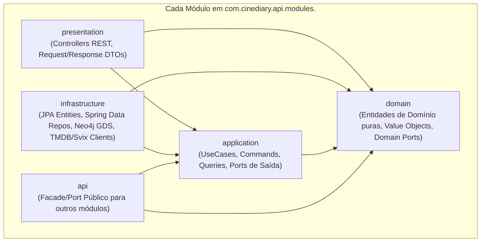
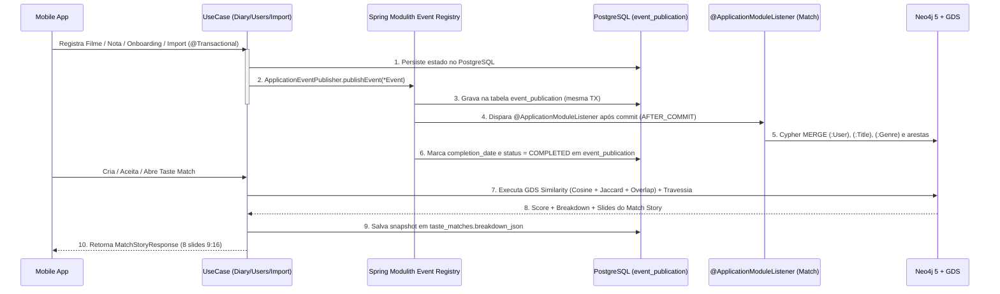
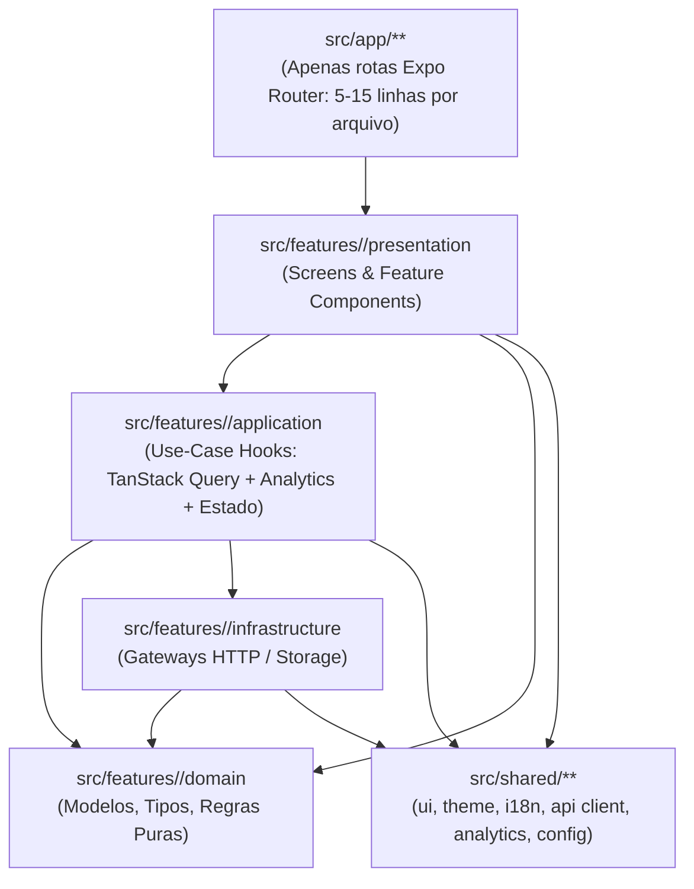

# CineDiary — Blueprint de Refatoração Clean Architecture v2.0 + Neo4j GDS

> **Versão:** 2.0 · **Data:** 13/11/2026  
> **Autor:** Architect Senior  
> **Objetivo:** Eliminar o acoplamento e a desorganização nos repositórios `cinediary-backend` e `cinediary-mobile`, impondo **Clean Architecture estrita**, **fronteiras reais entre módulos**, e introduzindo **Neo4j + Graph Data Science (GDS) + Transactional Outbox Pattern** para o cálculo do **Taste Match**.

---

## 1. Diagnóstico do que estava errado (Por que refatorar)

### No Backend (`cinediary-backend`)
1. **Pacotes planos sem camadas ("tudo jogado"):** Controllers REST, Services, Entidades JPA (`@Entity`), Repositórios Spring Data e clientes HTTP (`TmdbClient`) estavam misturados na mesma pasta (`com.cinediary.api.catalog.*`, `com.cinediary.api.users.*`).
2. **Violação de fronteira entre módulos:** `CatalogService` importava diretamente `UserTitleStateRepository` e `SeriesEpisodeLogRepository` de dentro do pacote `diary`.
3. **Módulos faltantes e cálculo sem grafo:** Faltavam os módulos completos de `diary` (use cases e controllers), `importing`, `stats` e `match`, além da integração com **Neo4j + GDS** via **Outbox Pattern**.

### No Frontend Mobile (`cinediary-mobile`)
1. **Mistura entre `core/`, `components/` e `features/`:** Chamadas de API estavam em `src/core/api/queries/me.ts`, regras de convite soltas em `src/features/match/pendingInvite.ts` e telas de abas em `src/app/(tabs)/` misturavam layout e estado.
2. **Ausência de separação Clean Architecture nas features:** Não havia divisão entre `domain`, `application`, `infrastructure` e `presentation`.
3. **Features de produto pendentes:** Onboarding (v1.2 sem mínimo obrigatório), Busca integrada, Registro em 3 toques (`log`), Progresso de Séries, Importação do Letterboxd, Estatísticas do Perfil e a experiência completa de **Taste Match (`together` + Match Story de 8 slides 9:16 + Watchlist Compartilhada)**.

---

## 2. Nova Arquitetura do Backend (`cinediary-backend`)

### 2.1. Regra de Dependência (Clean Architecture + Modular Monolith)



**Regras inegociáveis (verificadas por Spring Modulith `ApplicationModules.verify()` + ArchUnit em `ArchitectureFitnessTest`):**
1. **`domain` é 100% Java puro:** Proibido importar `jakarta.persistence.*`, `org.springframework.web.*`, `org.springframework.data.*` ou bibliotecas externas de infraestrutura no pacote `..domain..`.
2. **`application` orquestra apenas casos de uso:** Contém classes `*UseCase` anotadas com `@Service` e `@Transactional`. Depende apenas de `..domain..`, `..shared..` e de pacotes públicos `..modules.<outro>.api..`. Nunca importa `*JpaEntity`, `SpringData*Repository` ou `*Controller`.
3. **`infrastructure` implementa os Ports do `domain`/`application`:** Entidades JPA (`*JpaEntity`) e interfaces `SpringData*Repository` ficam isoladas em `..infrastructure.persistence..` (package-private sempre que possível) e são expostas ao domínio apenas via `*RepositoryAdapter`.
4. **`presentation` contém apenas entrada/saída HTTP:** Controllers REST (`*Controller`) chamam exclusivamente classes `*UseCase` de `..application..`.
5. **Comunicação entre módulos exclusivamente via pacote `api` (`@NamedInterface("api")` do Spring Modulith):** Cada módulo declara `package-info.java` com `@org.springframework.modulith.NamedInterface("api")` dentro do seu subpacote `api/`. O módulo `catalog` **NUNCA** acessa `modules.diary.infrastructure` ou `modules.diary.domain`; ele injeta `DiaryModulePort` ou escuta eventos públicos de `modules.<modulo>.api` via `@ApplicationModuleListener`.

### 2.2. Árvore de Pacotes Obrigatória do Backend (Spring Modulith 2.1.2 + Clean Arch)

```text
src/main/java/com/cinediary/api/
├── CineDiaryApplication.java
├── shared/
│   ├── package-info.java (@ApplicationModule(type = Type.OPEN))
│   ├── domain/
│   │   ├── DomainException.java
│   │   ├── NotFoundException.java
│   │   ├── AccountDeletedException.java
│   │   └── ExternalServiceUnavailableException.java
│   └── infrastructure/
│       ├── config/
│       │   ├── SecurityConfig.java
│       │   ├── CorsConfig.java
│       │   ├── OpenApiConfig.java
│       │   ├── Neo4jConfig.java
│       │   └── ModulithEventRetryScheduler.java (IncompleteEventPublications)
│       └── web/
│           └── ApiExceptionHandler.java
└── modules/
    ├── users/
    │   ├── api/
    │   │   ├── package-info.java (@NamedInterface("api"))
    │   │   ├── UsersModulePort.java
    │   │   ├── AuthenticatedUserDto.java
    │   │   ├── UserSyncedEvent.java
    │   │   └── UserOnboardingCompletedEvent.java
    │   ├── domain/
    │   │   ├── UserAccount.java
    │   │   ├── Usernames.java
    │   │   └── UserRepositoryPort.java
    │   ├── application/
    │   │   ├── GetCurrentUserUseCase.java
    │   │   ├── UpdateUserProfileUseCase.java
    │   │   ├── CompleteOnboardingUseCase.java (publica UserOnboardingCompletedEvent via ApplicationEventPublisher)
    │   │   ├── SyncClerkUserUseCase.java (publica UserSyncedEvent via ApplicationEventPublisher)
    │   │   └── UsersModuleFacade.java
    │   ├── infrastructure/
    │   │   ├── persistence/
    │   │   │   ├── UserJpaEntity.java
    │   │   │   ├── SpringDataUserRepository.java
    │   │   │   ├── ProcessedWebhookEventJpaEntity.java
    │   │   │   ├── SpringDataProcessedWebhookRepository.java
    │   │   │   └── UserRepositoryAdapter.java
    │   │   └── clerk/
    │   │       ├── ClerkProperties.java
    │   │       ├── WebhookConfiguration.java
    │   │       ├── WebhookVerifierService.java
    │   │       └── payload/ (ClerkUser.java, ClerkEmailAddress.java, WebhookEvent.java)
    │   └── presentation/
    │       ├── MeController.java
    │       ├── WebhookController.java
    │       └── dto/ (UserProfileResponse.java, UpdateProfileRequest.java, OnboardingRequest.java, OnboardingResponse.java)
    │
    ├── catalog/
    │   ├── api/
    │   │   ├── package-info.java (@NamedInterface("api"))
    │   │   ├── CatalogModulePort.java
    │   │   └── CatalogTitleView.java
    │   ├── domain/
    │   │   ├── CatalogTitleModel.java
    │   │   ├── SeasonModel.java
    │   │   ├── MediaType.java
    │   │   ├── GenreCatalog.java
    │   │   ├── CatalogRepositoryPort.java
    │   │   └── TmdbGatewayPort.java
    │   ├── application/
    │   │   ├── SearchCatalogUseCase.java
    │   │   ├── GetCatalogTitleDetailUseCase.java
    │   │   ├── GetPopularTitlesUseCase.java
    │   │   ├── GetGenresUseCase.java
    │   │   └── CatalogModuleFacade.java
    │   ├── infrastructure/
    │   │   ├── persistence/
    │   │   │   ├── CatalogTitleJpaEntity.java
    │   │   │   ├── CatalogSeasonJpaEntity.java
    │   │   │   ├── SpringDataCatalogTitleRepository.java
    │   │   │   ├── SpringDataCatalogSeasonRepository.java
    │   │   │   └── CatalogRepositoryAdapter.java
    │   │   └── tmdb/
    │   │       ├── TmdbProperties.java
    │   │       ├── TmdbHttpClient.java
    │   │       └── TmdbTitlePayload.java
    │   └── presentation/
    │       ├── CatalogController.java
    │       └── dto/ (CatalogSearchResponse.java, CatalogTitleSummary.java, CatalogTitleDetailResponse.java, GenreDto.java, SeasonDetailDto.java)
    │
    ├── diary/
    │   ├── api/
    │   │   ├── package-info.java (@NamedInterface("api"))
    │   │   ├── DiaryModulePort.java
    │   │   ├── UserTitleStateView.java
    │   │   └── TitleInteractionUpdatedEvent.java
    │   ├── domain/
    │   │   ├── TitleStateModel.java
    │   │   ├── DiaryEntryModel.java
    │   │   ├── SeriesStatus.java
    │   │   └── DiaryRepositoryPort.java
    │   ├── application/
    │   │   ├── UpdateTitleStateUseCase.java (publica TitleInteractionUpdatedEvent)
    │   │   ├── CreateDiaryEntryUseCase.java (publica TitleInteractionUpdatedEvent)
    │   │   ├── ListDiaryEntriesUseCase.java
    │   │   ├── UpdateSeriesEpisodesUseCase.java
    │   │   └── DiaryModuleFacade.java
    │   ├── infrastructure/
    │   │   └── persistence/
    │   │       ├── UserTitleStateJpaEntity.java
    │   │       ├── DiaryEntryJpaEntity.java
    │   │       ├── SeriesEpisodeLogJpaEntity.java
    │   │       ├── UserGenrePreferenceJpaEntity.java
    │   │       ├── UserTitleSignalJpaEntity.java
    │   │       ├── SpringDataUserTitleStateRepository.java
    │   │       ├── SpringDataDiaryEntryRepository.java
    │   │       ├── SpringDataSeriesEpisodeLogRepository.java
    │   │       └── DiaryRepositoryAdapter.java
    │   └── presentation/
    │       ├── DiaryController.java
    │       └── dto/ (UpdateTitleStateRequest.java, CreateDiaryEntryRequest.java, DiaryEntryResponse.java, SeriesEpisodeProgressRequest.java, SeriesProgressResponse.java)
    │
    ├── importing/
    │   ├── api/
    │   │   ├── package-info.java (@NamedInterface("api"))
    │   │   └── ImportConfirmedEvent.java
    │   ├── domain/
    │   │   ├── ImportJobModel.java
    │   │   ├── ImportJobStatus.java
    │   │   ├── LetterboxdParsedItem.java
    │   │   └── ImportJobRepositoryPort.java
    │   ├── application/
    │   │   ├── StartLetterboxdImportUseCase.java
    │   │   ├── GetImportJobUseCase.java
    │   │   ├── ConfirmImportJobUseCase.java (publica ImportConfirmedEvent)
    │   │   └── LetterboxdZipParser.java
    │   ├── infrastructure/
    │   │   └── persistence/
    │   │       ├── ImportJobJpaEntity.java
    │   │       ├── SpringDataImportJobRepository.java
    │   │       └── ImportJobRepositoryAdapter.java
    │   └── presentation/
    │       ├── ImportController.java
    │       └── dto/ (ImportJobResponse.java)
    │
    ├── stats/
    │   ├── domain/
    │   │   ├── UserStatsModel.java
    │   │   └── StatsQueryPort.java
    │   ├── application/
    │   │   └── GetUserStatsUseCase.java
    │   ├── infrastructure/
    │   │   └── persistence/
    │   │       └── StatsSqlQueryAdapter.java
    │   └── presentation/
    │       ├── StatsController.java
    │       └── dto/ (UserStatsResponse.java)
    │
    └── match/
        ├── api/
        │   ├── package-info.java (@NamedInterface("api"))
        │   └── MatchModulePort.java
        ├── domain/
        │   ├── TasteMatchModel.java
        │   ├── MatchStatus.java
        │   ├── MatchCalculationResult.java
        │   ├── MatchRepositoryPort.java
        │   └── TasteGraphEnginePort.java
        ├── application/
        │   ├── CreateTasteMatchUseCase.java
        │   ├── ListUserMatchesUseCase.java
        │   ├── AcceptTasteMatchUseCase.java
        │   ├── GetMatchStoryUseCase.java
        │   ├── RecalculateActiveMatchesUseCase.java
        │   ├── ManageSharedWatchlistUseCase.java
        │   ├── TasteGraphModulithEventListener.java (@ApplicationModuleListener)
        │   └── MatchModuleFacade.java
        ├── infrastructure/
        │   ├── persistence/
        │   │   ├── TasteMatchJpaEntity.java
        │   │   ├── MatchSharedWatchlistJpaEntity.java
        │   │   ├── SpringDataTasteMatchRepository.java
        │   │   ├── SpringDataSharedWatchlistRepository.java
        │   │   └── MatchRepositoryAdapter.java
        │   └── neo4j/
        │       ├── Neo4jTasteGraphProjector.java
        │       └── Neo4jGdsTasteMatchEngineAdapter.java
        └── presentation/
            ├── TasteMatchController.java
            └── dto/ (TasteMatchSummaryResponse.java, MatchStoryResponse.java, SharedWatchlistItemResponse.java)
```

---

## 3. Arquitetura Neo4j + Graph Data Science (GDS) + Outbox Nativo do Spring Modulith



### 3.0. Por que usar o Event Publication Registry do Spring Modulith (`2.1.2`)
- **Zero código de infraestrutura manual de Outbox:** Em vez de manter `OutboxEventJpaEntity`, `SpringDataOutboxRepository` e `OutboxRelayService`, usamos `org.springframework.modulith:spring-modulith-starter-jpa` (`BOM 2.1.2`, compatível com Spring Boot `4.1.2`).
- **Garantia Transacional Automática:** Ao publicar um record de evento via `ApplicationEventPublisher` dentro de um método `@Transactional`, o Spring Modulith serializa o evento em JSON e o grava na tabela `event_publication` na **mesma transação JPA**.
- **Entrega Assíncrona e Retries (`@ApplicationModuleListener` + `IncompleteEventPublications`):** O listener `TasteGraphModulithEventListener` no módulo `match` recebe o evento após o commit, projeta no Neo4j e recalcula matches ativos; só quando termina sem exceção o Spring Modulith preenche `completion_date`. Eventos incompletos são reenviados via `IncompleteEventPublications.resubmitIncompletePublicationsOlderThan(...)` e `spring.modulith.events.republish-outstanding-events-on-restart=true`.

### 3.1. Modelo de Grafo no Neo4j
- **Nós:**
  - `(:User {id: UUID, username: String})`
  - `(:Title {id: Long, tmdbId: Long, mediaType: String, titlePt: String, releaseYear: Int, posterPath: String, popularity: Float})`
  - `(:Genre {id: Int, name: String})`
- **Relacionamentos:**
  - `(u:User)-[r:INTERACTED {rating: Float, liked: Boolean, favorite: Boolean, watched: Boolean, signalOnly: Boolean, affinityWeight: Float, updatedAt: String}]->(t:Title)`
    - Onde `affinityWeight` é calculado na projeção:
      - Se `rating` presente: `rating / 5.0` (bônus `+0.15` se `liked` ou `favorite`, limitado a `1.0`)
      - Se apenas `liked` ou `favorite` ou `ONBOARDING_SEEN`: `0.80`
      - Se apenas `watched` sem nota/like: `0.60`
  - `(u:User)-[p:PREFERS_GENRE {source: String, weight: Float}]->(g:Genre)`
  - `(t:Title)-[:HAS_GENRE]->(g:Genre)`

### 3.2. Cálculo com Neo4j GDS (`Neo4jGdsTasteMatchEngineAdapter`)
1. **Verificação de "Match em construção" (`BUILDING`):**
   - Se `count((uA)-[:INTERACTED|PREFERS_GENRE]->()) == 0` ou `count((uB)-[:INTERACTED|PREFERS_GENRE]->()) == 0`, o Match fica com `status = BUILDING`, `compatibilityScore = null`, `statusLabel = "Match em construção"`.
2. **Cálculo via GDS Similarity Functions & Procedures (`gds.similarity.cosine` e `gds.similarity.jaccard`) + Cypher:**
   - **Componente 1 — Notas e Afinidade em Títulos Comuns (`ratingsScore`, peso 50%):**
     - Combina a proximidade direta de notas `1.0 - abs(rA.rating - rB.rating) / 4.5` com a similaridade de cosseno do GDS `gds.similarity.cosine(vecA, vecB)` sobre os vetores de pesos dos títulos interagidos.
   - **Componente 2 — Afinidade de Gêneros no Grafo (`genresScore`, peso 30%):**
     - Calcula `gds.similarity.jaccard` / cosseno ponderado sobre os gêneros conectados a `uA` e `uB` (tanto por `[:PREFERS_GENRE]` quanto por caminhos `(u)-[:INTERACTED]->(t)-[:HAS_GENRE]->(g)` onde `affinityWeight >= 0.7`).
   - **Componente 3 — Favoritos e Curtidos (`favoritesScore`, peso 20%):**
     - Similaridade de overlap no subgrafo de títulos com `liked = true`, `favorite = true` ou `rating >= 4.0`.
   - **Modo Descoberta (`discoveryMode = true` quando `< 3` títulos avaliados em comum):**
     - Pesos ajustados automaticamente para `65% Gêneros + 35% Favoritos/Sinais`.
3. **Travessia de Grafo para Recomendações Conjuntas (`jointRecommendations`) e Descobertas (`discoveryPicks`):**
   - `discoveryPicks`: Títulos onde `(uA)-[r:INTERACTED]->(t)` com `r.affinityWeight >= 0.8` e `NOT (uB)-[:INTERACTED]->(t)` (e vice-versa).
   - `jointRecommendations`: Títulos no grafo conectados aos gêneros em comum `(g:Genre)<-[:HAS_GENRE]-(t:Title)` que **nenhum dos dois** assistiu (`NOT (uA)-[:INTERACTED]->(t) AND NOT (uB)-[:INTERACTED]->(t)`), ordenados pelo número de gêneros compartilhados e popularidade.

---

## 4. Nova Arquitetura do Frontend Mobile (`cinediary-mobile`)

### 4.1. Regra de Dependência no Mobile (Feature-Sliced Clean Architecture)



**Regras inegociáveis no Mobile:**
1. **`src/app/` contém APENAS arquivos de rota do Expo Router:** Cada arquivo em `src/app/` apenas importa e exporta a Screen correspondente de `src/features/<feature>/presentation/screens/`. Nenhuma lógica de negócio, chamada de API ou `StyleSheet` grande dentro de `src/app/`.
2. **Consolidação em `src/shared/`:** Todo o código transversal (antes espalhado entre `src/core/`, `src/theme/` e `src/components/`) fica organizado em `src/shared/{api,analytics,auth,config,i18n,theme,ui}`.
3. **4 camadas em cada feature (`src/features/{auth,catalog,diary,importing,stats,match}`):**
   - `domain/`: Tipos, interfaces e funções puras (zero imports de React ou `openapi-fetch`).
   - `infrastructure/`: Chamadas HTTP (`*Api.ts`) e persistência local (`SecureStore`).
   - `application/`: Hooks de casos de uso (`use*`) que encapsulam `useQuery`/`useMutation`, invalidação de cache e disparo dos 9 eventos do PostHog.
   - `presentation/`: `screens/` e `components/` puramente visuais, consumindo apenas `application/` e `src/shared/ui/`.

### 4.2. Escopo Completo do Frontend + Feature de Taste Match
O `Programador FrontEnd Mobile Senior` deve entregar todas as features funcionais conectadas aos contratos da API:
1. **`auth` + Onboarding (v1.2):**
   - Login/Cadastro (usuário, e-mail e senha) + Onboarding em 3 passos opcionais (Gêneros, Filmes conhecidos sem mínimo obrigatório com botão *"Pular por agora"* / *"Continuar"*, Favoritos se marcou filmes + checkbox *"Adicionar ao meu histórico"* desmarcado por padrão).
2. **`catalog` (Buscar + Detalhes de Filme/Série):**
   - Aba `Buscar` com busca unificada (Filmes, Séries, Todos), filtro de gêneros e títulos populares.
   - Tela de Detalhes (`title/[mediaType]/[tmdbId]`) com sinopse, nota, curtida, watchlist e, para **Séries**, acordeão de temporadas e checklist de episódios com barra de progresso (`WATCHING`, `COMPLETED`, `DROPPED`).
3. **`diary` (Início + Registrar em 3 toques):**
   - Aba `Início`: Novidades do Juntos, "Continue assistindo" e linha do tempo do diário.
   - Aba `Registrar` (`log`): *"O que você viu hoje?"* com busca rápida, atalhos da watchlist e séries em andamento, e modal/sheet de **registro em 3 toques** (Pôster → Estrela → Registrar, com suporte a rewatch e review textual).
4. **`importing` (Letterboxd ZIP):**
   - Fluxo acessível pelo Perfil: instruções, seleção de arquivo `.zip`, status do processamento, card de resumo (`matched` vs `unmatched`) e confirmação idempotente.
5. **`stats` (Perfil):**
   - Aba `Perfil`: 4 favoritos, totais de filmes e séries, nota média, top gêneros, gráfico de filmes por mês, chave de perfil público/privado e atalho para Importação do Letterboxd.
6. **`match` (Aba `Juntos` / `Together` + Match Story 8 Slides 9:16 + Watchlist Compartilhada):**
   - **Hub `Juntos` (`TogetherHubScreen`):**
     - Criar novo Taste Match e compartilhar link/código de convite.
     - Inserir/aceitar código de convite de um amigo.
     - Listar Matches nos estados: `PENDING` (*"Aguardando seu amigo"*), `BUILDING` (*"Match em construção: registre alguns filmes para ver o resultado"*) e `ACTIVE` (com porcentagem e avatares).
   - **Detalhe do Match (`MatchDetailScreen`):**
     - Resumo da compatibilidade (com explicação dos pesos `50% Notas · 30% Gêneros · 20% Favoritos` ou `Modo Descoberta`), botão de destaque para abrir o **Match Story** e seção completa de **Watchlist Compartilhada** (listar, adicionar título via busca rápida e remover).
   - **Match Story 9:16 (`MatchStoryScreen`):**
     - Preservar integralmente a experiência visual de **8 slides 9:16** aprovada pelo usuário (Abertura, Porcentagem + Explicação, Gêneros em Comum, Ambos Amam, Onde Discordam, Modo Descoberta / "O que um ama e o outro não viu", Recomendações do Grafo para Verem Juntos, Card Final de Compartilhamento), com barra de progresso superior, navegação por toque e compartilhamento de slide.
