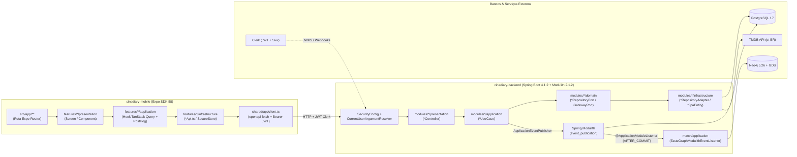

# CineDiary v2.1 — Guia Completo de Fluxos, Classes, Serviços e Manutenção Manual (Front + Back)

> **Objetivo deste documento:** Explicar ponta a ponta cada fluxo do CineDiary (do toque na tela do celular até o PostgreSQL, Spring Modulith e Neo4j GDS) e mapear **cada classe, service, use case, port, adapter, hook, gateway e tela** do Backend (`cinediary-backend`) e do Frontend Mobile (`cinediary-mobile`), indicando **quem chama o quê** e **exatamente onde mexer** quando você quiser alterar qualquer comportamento na mão.

---

## Sumário
1. [Visão Geral da Arquitetura e Comunicação Front ↔ Back](#1-visão-geral-da-arquitetura-e-comunicação-front--back)
2. [Os 7 Fluxos Ponta a Ponta (Quem Chama O Quê)](#2-os-7-fluxos-ponta-a-ponta-quem-chama-o-quê)
3. [Mapa Completo do Backend (`cinediary-backend`) — Classe por Classe](#3-mapa-completo-do-backend-cinediary-backend--classe-por-classe)
   - [3.1. Raiz e `shared` (Segurança, JWT, CORS, Erros, Retry do Modulith)](#31-raiz-e-shared-segurança-jwt-cors-erros-retry-do-modulith)
   - [3.2. Módulo `users` (Clerk Auth, Webhooks Svix, Perfil `/me`, Onboarding)](#32-módulo-users-clerk-auth-webhooks-svix-perfil-me-onboarding)
   - [3.3. Módulo `catalog` (Busca TMDB, Populares, Gêneros, Detalhes + Cache 7 dias)](#33-módulo-catalog-busca-tmdb-populares-gêneros-detalhes--cache-7-dias)
   - [3.4. Módulo `diary` (Notas, Curtidas, Watchlist, Diário, Episódios de Séries)](#34-módulo-diary-notas-curtidas-watchlist-diário-episódios-de-séries)
   - [3.5. Módulo `importing` (Upload e Reconciliação Assíncrona do ZIP do Letterboxd)](#35-módulo-importing-upload-e-reconciliação-assíncrona-do-zip-do-letterboxd)
   - [3.6. Módulo `stats` (Estatísticas do Perfil)](#36-módulo-stats-estatísticas-do-perfil)
   - [3.7. Módulo `match` (Taste Match, Neo4j 5 GDS, Outbox Listener, Match Story 8 Slides, Watchlist Compartilhada)](#37-módulo-match-taste-match-neo4j-5-gds-outbox-listener-match-story-8-slides-watchlist-compartilhada)
   - [3.8. Migrations Flyway (`V1` a `V4`) e Testes](#38-migrations-flyway-v1-a-v4-e-testes)
4. [Mapa Completo do Frontend Mobile (`cinediary-mobile`) — Arquivo por Arquivo](#4-mapa-completo-do-frontend-mobile-cinediary-mobile--arquivo-por-arquivo)
   - [4.1. Camada de Rotas (`src/app/**` — Expo Router)](#41-camada-de-rotas-srcapp--expo-router)
   - [4.2. Camada `src/shared/**` (API Client, Auth, Env/IP, PostHog, i18n, Theme, UI)](#42-camada-srcshared--api-client-auth-envip-posthog-i18n-theme-ui)
   - [4.3. Feature `auth` (Welcome, SignIn, SignUp, Guard de Sessão e Onboarding v1.2)](#43-feature-auth-welcome-signin-signup-guard-de-sessão-e-onboarding-v12)
   - [4.4. Feature `catalog` (Aba Buscar, Detalhe do Título e Temporadas/Episódios)](#44-feature-catalog-aba-buscar-detalhe-do-título-e-temporadasepisódios)
   - [4.5. Feature `diary` (Aba Início, Aba Registrar e QuickLog 3 Toques)](#45-feature-diary-aba-início-aba-registrar-e-quicklog-3-toques)
   - [4.6. Feature `importing` (Fluxo de Importação do ZIP do Letterboxd)](#46-feature-importing-fluxo-de-importação-do-zip-do-letterboxd)
   - [4.7. Feature `stats` (Aba Perfil e Estatísticas)](#47-feature-stats-aba-perfil-e-estatísticas)
   - [4.8. Feature `match` (Aba Juntos, Convites, Sala do Match, Watchlist Compartilhada e Match Story 9:16)](#48-feature-match-aba-juntos-convites-sala-do-match-watchlist-compartilhada-e-match-story-916)
5. [Guia Prático de Manutenção Manual ("Quero alterar X na mão, onde eu mexo?")](#5-guia-prático-de-manutenção-manual-quero-alterar-x-na-mão-onde-eu-mexo)

---

## 1. Visão Geral da Arquitetura e Comunicação Front ↔ Back

### Como as camadas conversam
- **No Mobile (`cinediary-mobile`):**
  1. **`src/app/`** tem apenas arquivos de 5–10 linhas que apontam para a tela real em `src/features/<feature>/presentation/screens/`.
  2. **`presentation/`** renderiza a interface usando componentes de `src/shared/ui/` e chama hooks de `application/`. **Proibido** chamar `api.GET`/`api.POST` direto na tela.
  3. **`application/`** contém os hooks do TanStack Query (`useQuery`, `useMutation`), invalida os caches (`queryKeys.ts`) e dispara os eventos do PostHog (`analytics.tsx`). Ele chama funções de `infrastructure/` e regras puras de `domain/`.
  4. **`infrastructure/`** (`*Api.ts`) chama o cliente HTTP tipado (`src/shared/api/client.ts`), que injeta automaticamente o header `Authorization: Bearer <token_do_clerk>` (configurado pelo `SessionBridge` dentro de `AppProviders.tsx`).
- **No Backend (`cinediary-backend`):**
  1. **`SecurityConfig`** valida a assinatura do JWT do Clerk via OAuth2 Resource Server.
  2. **`CurrentUserArgumentResolver`** intercepta qualquer parâmetro `CurrentUser user` nos métodos dos Controllers, extrai o `sub` (`clerkUserId`) do JWT e chama `CurrentUserProvider.resolve(...)` (que busca o usuário no banco ou cria na hora via **JIT Provisioning** se o webhook do Clerk ainda não tiver chegado; se o usuário estiver com `deleted_at != null`, lança `AccountDeletedException` → HTTP `403`).
  3. **`presentation/` (`*Controller`)** recebe o request DTO validado (`@Valid`), chama um único `*UseCase` da camada `application/` e devolve o response DTO.
  4. **`application/` (`*UseCase`)** abre a transação (`@Transactional`), executa as regras de negócio chamando modelos de `domain/`, portas de persistência (`*RepositoryPort`), portas de outros módulos (`modules.<outro>.api.*Port`) e publica eventos de domínio (`ApplicationEventPublisher.publishEvent(...)`).
  5. **Spring Modulith Outbox (`event_publication`)**: quando um `*UseCase` publica um evento (`UserSyncedEvent`, `UserOnboardingCompletedEvent`, `TitleInteractionUpdatedEvent`, `ImportConfirmedEvent`), o Spring Modulith grava o evento serializado na tabela `event_publication` **na mesma transação do PostgreSQL**.
  6. **Após o commit (`AFTER_COMMIT`)**, o `TasteGraphModulithEventListener` (no módulo `match`) recebe o evento de forma assíncrona, projeta os nós e arestas no **Neo4j 5 + GDS** via `Neo4jTasteGraphProjector` e recalcula os Matches do usuário via `RecalculateActiveMatchesUseCase`.

---

## 2. Os 7 Fluxos Ponta a Ponta (Quem Chama O Quê)

### Fluxo 1: Abertura do App, Autenticação Clerk e Guard de Sessão (`/me`)
1. **Inicialização (`src/app/_layout.tsx` → `AppProviders.tsx`):**
   - `AppProviders` inicializa fontes (`Fraunces` e `Nunito`), `PostHogProvider`, `ClerkProvider` (com `tokenCache` no `SecureStore`), `QueryClientProvider` e o `SessionBridge`.
   - O `SessionBridge` registra `setAuthTokenProvider(() => getToken())` no `src/shared/api/client.ts` e sincroniza o usuário autenticado com o PostHog (`posthog.identify`).
2. **Cadastro / Login (`WelcomeScreen` → `SignUpScreen` / `SignInScreen`):**
   - A tela chama o hook `usePasswordSignUp()` ou `usePasswordSignIn()` em `src/features/auth/application/usePasswordAuth.ts`.
   - O hook valida os campos via `src/features/auth/domain/credentials.ts`, chama `signUp.create({ username, emailAddress, password })` ou `signIn.create({ identifier, password })` do `@clerk/expo`, ativa a sessão (`setActive`) e dispara `user_signed_up` / `user_signed_in` no PostHog.
   - Em paralelo, o Clerk envia o webhook `user.created` para `POST /api/v1/webhooks/clerk` → `WebhookController` → `SyncClerkUserUseCase` → `WebhookVerifierService` (valida assinatura Svix) → `ProcessedWebhookAdapter` (deduplica por `svix_id` na tabela `webhook_events`) → `UserRepositoryAdapter.upsertFromClerk(...)` → publica `UserSyncedEvent` → `TasteGraphModulithEventListener` cria `(:User)` no Neo4j.
3. **Decisão de Rota (`RootNavigator.tsx`):**
   - Assim que `isSignedIn === true`, o `RootNavigator` chama `useMe()` (`src/features/auth/application/profileQueries.ts`) → `profileApi.getMe()` → `GET /api/v1/me`.
   - No backend: `CurrentUserArgumentResolver` → `CurrentUserProvider.resolve()` → `ResolveCurrentUserUseCase` (se o webhook atrasou, cria o usuário no PostgreSQL via JIT com `@cinefilo_XXXXXX`) → `MeController.me()` → `GetCurrentUserUseCase` → retorna `UserProfileView` (incluindo `onboardingCompleted`).
   - Enquanto `/me` carrega, o `RootNavigator` exibe `SessionLoadingScreen`. Se falhar (ex.: IP incorreto ou API desligada), exibe `SessionErrorScreen` com botões *"Tentar de novo"* e *"Sair"*.
   - Se `onboardingCompleted === false`, abre o grupo `(onboarding)` começando por `genres.tsx`. Se `true`, libera o grupo `(tabs)`.

---

### Fluxo 2: Onboarding Cinematográfico v1.2 (Sem Mínimo Obrigatório)
1. **Passo 1 — Gêneros (`OnboardingGenresScreen.tsx`):**
   - Busca a lista de gêneros via `useGenres()` (`catalogQueries.ts`) → `GET /api/v1/catalog/genres` → `CatalogController.genres()` → `GetGenresUseCase` → `GenreNamesService`.
   - O usuário marca quantos gêneros quiser (inclusive `0`) no estado compartilhado `useOnboardingStore` (`useOnboarding.ts`). O botão exibe *"Pular por agora"* (se `0`) ou *"Continuar"* (se `> 0`) e navega para `/(onboarding)/seen`.
2. **Passo 2 — Filmes Conhecidos (`OnboardingSeenScreen.tsx`):**
   - Carrega populares via `usePopularTitles('MOVIE')` (`GET /api/v1/catalog/popular`) e permite buscar via `useCatalogSearch` (`GET /api/v1/catalog/search`).
   - Se o usuário marcou `>= 1` filme, avança para `/(onboarding)/favorites`.
   - Se o usuário marcou `0` filmes e clicou em *"Pular por agora"*, pula a tela de favoritos e chama direto `useFinishOnboarding()` (`useFinishOnboarding.ts`).
3. **Passo 3 — Favoritos e Histórico (`OnboardingFavoritesScreen.tsx`):**
   - Permite escolher até 4 favoritos dentre os filmes marcados no passo anterior e traz o checkbox *"Adicionar esses filmes ao meu diário como já assistidos"* (`addToHistory`, desmarcado por padrão).
   - Ao concluir, `useFinishOnboarding` lê se existe convite salvo no `SecureStore` (`pendingInviteStorage.ts`) e chama `useCompleteOnboardingMutation` → `POST /api/v1/me/onboarding`.
4. **No Backend (`MeController.onboarding` → `CompleteOnboardingUseCase`):**
   - Salva os gêneros em `user_genre_preferences` via `DiaryModulePort.recordOnboardingSignals(...)` (`DiaryModuleFacade` → `DiaryRepositoryAdapter`).
   - Se `addToHistory === true`, faz upsert de cada título como `watched = true` (e `favorite = true` para os favoritos) em `user_title_states`. Se `addToHistory === false`, grava apenas em `user_title_signals` (`ONBOARDING_SEEN` / `ONBOARDING_FAVORITE`) para alimentar o Taste Match sem poluir o diário.
   - Marca `users.onboarding_completed = true`.
   - Se veio `pendingInviteCode`, chama `PendingInviteAcceptor.acceptPendingInvite(...)` (implementado por `MatchModuleFacade`) para aceitar automaticamente o Match!
   - Publica `UserOnboardingCompletedEvent` no Outbox do Spring Modulith (`event_publication`) → `TasteGraphModulithEventListener` projeta gêneros e sinais no Neo4j e recalcula os Matches.

---

### Fluxo 3: Busca no Catálogo, Detalhes de Filme/Série e Cache TMDB
1. **Busca e Populares (`SearchScreen.tsx` / `CatalogSearchPanel.tsx`):**
   - Chama `useCatalogSearch(query, type)` ou `usePopularTitles(type)` (`catalogQueries.ts`) → `catalogApi.ts` → `GET /api/v1/catalog/search` ou `/popular`.
   - No backend: `CatalogController` → `SearchCatalogUseCase` / `GetPopularTitlesUseCase`:
     - Consulta o TMDB em `pt-BR` via `TmdbHttpClient` (`TmdbGatewayPort`).
     - Faz upsert dos títulos retornados na tabela `catalog_titles` via `CatalogCachingService` → `CatalogRepositoryAdapter` (`SpringDataCatalogTitleRepository.upsertTitle`).
     - Consulta o estado do usuário logado (`watched`, `rating`, `liked`, `inWatchlist`) para esses títulos chamando a porta `ViewerTitleStatePort` (implementada por `DiaryViewerStateProvider` no módulo `diary`).
     - Se o TMDB estiver fora do ar (`ExternalServiceUnavailableException`), faz fallback automático para busca textual local no PostgreSQL (`catalog_titles`) e devolve `source = "CACHE"`.
2. **Detalhe de Filme ou Série (`TitleDetailScreen.tsx`):**
   - Rota `/title/[mediaType]/[tmdbId]` chama `useTitleDetail(mediaType, tmdbId)` → `GET /api/v1/catalog/{mediaType}/{tmdbId}` → `GetCatalogTitleDetailUseCase`.
   - Se o título não estiver no banco ou `details_synced_at` tiver mais de **7 dias**, busca detalhes e temporadas (`catalog_seasons`, ignorando temporada `0` "Especiais") no TMDB e atualiza o cache local.
   - Anexa o `userState` do usuário (incluindo episódios marcados e `seriesStatus`) via `ViewerTitleStatePort`.

---

### Fluxo 4: Registro em 3 Toques (QuickLog), Diário e Progresso de Séries
1. **Aba Registrar (`LogScreen.tsx`) e Modal QuickLog (`QuickLogScreen.tsx`):**
   - Na busca, watchlist ou detalhe, tocar em `+` ou numa estrela abre `/quick-log/[mediaType]/[tmdbId]` (`QuickLogScreen` → `QuickLogForm` → `useQuickLog.ts`).
   - **Se o usuário apenas altera estado rápido (nota, curtida, watchlist, assistido sem data específica):**
     - Chama `useUpdateTitleStateMutation` (`titleStateMutations.ts`) → `PUT /api/v1/titles/{titleId}/state` → `DiaryController.updateState` → `UpdateTitleStateUseCase`.
   - **Se o usuário registra uma entrada datada no diário (com data `watchedOn`, `rewatch`, `reviewText`):**
     - Chama `useCreateDiaryEntryMutation` (`diaryQueries.ts`) → `POST /api/v1/diary/entries` → `DiaryController.createEntry` → `CreateDiaryEntryUseCase`.
     - Insere em `diary_entries` e sincroniza `user_title_states` (`watched = true`, nota, curtida).
   - **Em ambos os casos:** o UseCase publica `TitleInteractionUpdatedEvent(userId, titleId)` via `ApplicationEventPublisher` → gravado em `event_publication` → `TasteGraphModulithEventListener` projeta a aresta `(:User)-[:INTERACTED]->(:Title)` no Neo4j e recalcula os Matches ativos/em construção da pessoa!
2. **Checklist de Episódios de Série (`SeriesProgressSection.tsx`):**
   - Chama `useUpdateSeriesEpisodesMutation` → `PUT /api/v1/series/{titleId}/episodes` → `DiaryController.updateEpisodes` → `UpdateSeriesEpisodesUseCase`.
   - Grava/remove os episódios em `series_episode_logs`, calcula `watchedEpisodes` vs `totalEpisodes` (de `catalog_seasons`) e atualiza automaticamente o `series_status` em `user_title_states` (`WATCHING` se parcial, `COMPLETED` e `watched = true` se `100%`).

---

### Fluxo 5: Importação Assíncrona e Idempotente do Letterboxd (`ImportScreen.tsx`)
1. **Upload (`POST /api/v1/imports/letterboxd`):**
   - `useImportFlow.ts` seleciona o arquivo `.zip` via `expo-document-picker`, salva o `jobId` ativo no `SecureStore` (`activeImportStorage.ts`) e envia via `importApi.uploadLetterboxdZip` → `ImportController.upload` → `StartLetterboxdImportUseCase`.
   - Valida o tamanho (`ImportLimits.MAX_ZIP_BYTES = 20 MB`), cria o registro em `import_jobs` com status `PROCESSING` e dispara `ImportJobProcessor.processAsync(...)` na pool `importTaskExecutor` (`AsyncConfig.java`).
2. **Reconciliação em Background (`ImportJobProcessor` + `LetterboxdZipParser`):**
   - Lê `watched.csv`, `ratings.csv`, `diary.csv` e `likes/films.csv` em memória (protegido contra Zip Slip e Zip Bomb).
   - Para cada filme único (título + ano), chama `CatalogModulePort.reconcileMovie(title, year)` (`CatalogModuleFacade`), que busca primeiro no cache PostgreSQL e depois no TMDB.
   - Calcula o `import_hash` (`SHA-256` de `userId + titleId + watchedOn + rating`) e salva os itens reconciliados em `summary_json` com status `AWAITING_CONFIRMATION`.
3. **Polling e Confirmação (`GET /api/v1/imports/{jobId}` e `POST /api/v1/imports/{jobId}/confirm`):**
   - O app consulta `GET /api/v1/imports/{jobId}` a cada 2 segundos até `status === 'AWAITING_CONFIRMATION'` e exibe `ImportSummary.tsx` (`matchedCount` vs `unmatchedCount`).
   - Quando o usuário toca em **Confirmar importação**, chama `ConfirmImportJobUseCase` → `DiaryModulePort.applyImportedItems(...)`:
     - Faz `INSERT INTO diary_entries ... ON CONFLICT (user_id, import_hash) DO NOTHING` (100% idempotente: importar o mesmo ZIP de novo adiciona `0` duplicatas).
     - Atualiza `user_title_states` preservando notas que o usuário já tinha dado manualmente no app.
     - Publica `ImportConfirmedEvent` → `TasteGraphModulithEventListener` sincroniza todos os títulos do usuário no Neo4j e recalcula seus Matches.

---

### Fluxo 6: Estatísticas e Perfil (`ProfileScreen.tsx`)
1. `ProfileScreen.tsx` chama `useMe()` (`GET /api/v1/me`) para os 4 favoritos e dados da conta, e `useMyStats()` (`useMyStats.ts`) → `GET /api/v1/users/{username}/stats`.
2. No backend: `StatsController.stats` → `GetUserStatsUseCase`:
   - Verifica via `UsersModulePort.findByUsername(username)` se o perfil existe e se é público (ou se o solicitante é o próprio dono; caso contrário lança `ForbiddenException` → HTTP `403`).
   - Chama `StatsSqlQueryAdapter` (`StatsQueryPort`), que executa agregações SQL em `user_title_states` e `diary_entries` retornando: `moviesWatched`, `seriesWatched`, `entriesLast12Months`, `averageRating`, `topGenres` e `moviesPerMonth`.

---

### Fluxo 7: Taste Match, Neo4j 5 + GDS, Match Story 9:16 e Watchlist Compartilhada
1. **Criar Convite (`TogetherHubScreen.tsx` → `POST /api/v1/matches`):**
   - `CreateTasteMatchUseCase` gera um código único de 8 caracteres (`InviteCodes.generate()`, sem caracteres ambíguos `0/O/1/I`) e cria uma linha em `taste_matches` com `status = PENDING`.
   - O app exibe `InviteCreatedCard.tsx` com o código e link `cinediary://match/invite/{code}`.
2. **Aceitar Convite (`AcceptInviteScreen.tsx` ou `TogetherHubScreen.tsx` → `POST /api/v1/matches/{inviteCode}/accept`):**
   - `AcceptTasteMatchUseCase` valida que o convidado não é o próprio criador (`ConflictException`), vincula `partner_user_id` e chama `MatchCalculator.calculateAndPersist(...)`.
3. **Como o `MatchCalculator` calcula a compatibilidade (Neo4j GDS + Fallback SQL):**
   - Carrega os perfis de gosto de `userA` e `userB` via `TasteDataLoader` (`DiaryModulePort` + `CatalogModulePort`).
   - **Regra do Estado `BUILDING` ("Match em construção"):** se `userA` ou `userB` tiver `0` interações e `0` gêneros (porque pulou o onboarding e ainda não registrou nada), o Match é salvo com `status = BUILDING`, `compatibilityScore = null` e o card mostra *"Match em construção: registre alguns filmes para ver o resultado"*.
   - **Se ambos têm dados:**
     - Tenta primeiro o motor primário `Neo4jGdsTasteMatchEngineAdapter`:
       - Garante que os dados da dupla estão projetados no Neo4j (`Neo4jTasteGraphProjector`).
       - Executa a query Cypher + funções do plugin **Graph Data Science (`gds.similarity.cosine`, `gds.similarity.jaccard`, `gds.similarity.overlap`)** para obter a similaridade no grafo e a travessia de recomendações (`jointRecommendations` e `discoveryPicks`).
       - Se o Neo4j estiver offline, cai automaticamente para o `RelationalTasteMatchEngineAdapter` (`engineUsed = SQL_FALLBACK`), que aplica a mesma matemática via `TasteSimilarityCalculator`.
     - **Pesos da Fórmula (`TasteWeights.java`):**
       - Modo Normal (`>= 3` títulos avaliados em comum): **50% Notas (`ratingsScore`) + 30% Gêneros (`genresScore`) + 20% Favoritos/Curtidos (`favoritesScore`)**.
       - Modo Descoberta (`< 3` títulos avaliados em comum): `discoveryMode = true`, **65% Gêneros + 35% Favoritos/Sinais**.
     - Monta os **8 slides do Match Story** via `MatchStoryAssembler.java`, salva o snapshot em `taste_matches.breakdown_json` com `status = ACTIVE` e retorna `MatchStoryResponse`.
4. **Match Story 9:16 (`MatchStoryScreen.tsx`) e Watchlist Compartilhada (`MatchDetailScreen.tsx`):**
   - `MatchStoryScreen` usa `useStoryPlayer.ts` (timer de 6s por slide, pausa ao segurar, avanço/recuo por toque) e `StorySlides.tsx` para renderizar os slides 9:16, e `useShareSlide.ts` (`react-native-view-shot` + `expo-sharing`) para exportar o slide em PNG `1080x1920`.
   - `MatchDetailScreen` exibe as barras de explicação (`BreakdownBars.tsx`) e a Watchlist Compartilhada (`SharedWatchlistGrid.tsx` + `AddToSharedWatchlistScreen.tsx` → `GET / POST / DELETE /api/v1/matches/{matchId}/watchlist` → `ManageSharedWatchlistUseCase`).

---

## 3. Mapa Completo do Backend (`cinediary-backend`) — Classe por Classe

Caminho base: `cinediary-backend/src/main/java/com/cinediary/api/`

### 3.1. Raiz e `shared` (Segurança, JWT, CORS, Erros, Retry do Modulith)

| Arquivo / Classe | Camada | O que faz | Quem chama → O que ela chama |
| --- | --- | --- | --- |
| `CineDiaryApplication.java` | Raiz | Classe principal `@SpringBootApplication` e `@ConfigurationPropertiesScan`. | Inicializada pelo Spring Boot. |
| `shared/package-info.java` | Modulith | Declara `@ApplicationModule(type = Type.OPEN)` para que todos os módulos possam usar `shared`. | Lido pelo Spring Modulith. |
| `shared/domain/CurrentUser.java` | `domain` | Record `(UUID id, String clerkUserId, String username)` representando o usuário autenticado. | Injetado nos métodos dos `*Controller` pelo `CurrentUserArgumentResolver`. |
| `shared/domain/AuthenticatedPrincipal.java` | `domain` | Record `(String clerkUserId, String displayName, String avatarUrl)` extraído das claims do JWT. | Criado por `CurrentUserArgumentResolver` → passado para `CurrentUserProviderPort`. |
| `shared/domain/DomainException.java` e subclasses (`NotFoundException`, `ConflictException`, `ForbiddenException`, `DomainValidationException`, `AccountDeletedException`, `ExternalServiceUnavailableException`) | `domain` | Hierarquia de exceções de negócio puras (sem dependência de Spring Web). | Lançadas pelos `*UseCase` e adapters → capturadas por `ApiExceptionHandler`. |
| `shared/application/CurrentUserProviderPort.java` | `application` | Interface que resolve `AuthenticatedPrincipal` em `CurrentUser`. | Chamada por `CurrentUserArgumentResolver` → implementada por `users.application.CurrentUserProvider`. |
| `shared/infrastructure/config/SecurityConfig.java` | `infrastructure` | Configura Spring Security: libera `/actuator/health`, Swagger e `/api/v1/webhooks/clerk`; exige JWT Clerk no resto; configura `JwtDecoder` tolerante a clock skew (60s). | Filtro HTTP de entrada do Spring Security. |
| `shared/infrastructure/config/CorsConfig.java` | `infrastructure` | Lê `CORS_ALLOWED_ORIGINS` (`cinediary.cors.allowed-origins`) e libera métodos `GET/POST/PUT/PATCH/DELETE/OPTIONS` e header `Authorization`. | Usado pelo `SecurityConfig`. |
| `shared/infrastructure/config/ClerkJwtProperties.java` | `infrastructure` | Lê `cinediary.clerk.issuer` e `jwk-set-uri` do `application.yml`. | Usado por `SecurityConfig`. |
| `shared/infrastructure/config/Neo4jConfig.java` & `Neo4jProperties.java` | `infrastructure` | Cria o bean `org.neo4j.driver.Driver` conectado ao container Neo4j (`bolt://localhost:7687`) quando `cinediary.neo4j.enabled=true`. | Injetado em `Neo4jTasteGraphProjector` e `Neo4jGdsTasteMatchEngineAdapter`. |
| `shared/infrastructure/config/AsyncConfig.java` | `infrastructure` | Habilita `@EnableAsync` e `@EnableScheduling` e cria o executor `importTaskExecutor` (2 a 4 threads) para processar ZIPs do Letterboxd. | Usado por `ImportJobProcessor` e `ModulithEventRetryScheduler`. |
| `shared/infrastructure/config/ModulithEventRetryScheduler.java` | `infrastructure` | A cada 30s (`@Scheduled`), chama `IncompleteEventPublications.resubmitIncompletePublicationsOlderThan(Duration.ofSeconds(15))` para reenviar eventos que falharam (ex.: Neo4j estava desligado). | Executado em background pelo Spring Scheduling. |
| `shared/infrastructure/config/OpenApiConfig.java` | `infrastructure` | Configura o Swagger UI (`/swagger-ui.html`) com autenticação Bearer JWT. | Lido pelo `springdoc-openapi`. |
| `shared/infrastructure/web/CurrentUserArgumentResolver.java` & `WebMvcConfig.java` | `infrastructure` | Lê o `Jwt` do `SecurityContextHolder` e injeta `CurrentUser` automaticamente nos parâmetros dos Controllers. | Chamado pelo Spring MVC antes de cada método de Controller autenticado. |
| `shared/infrastructure/web/ApiExceptionHandler.java` | `infrastructure` | `@RestControllerAdvice` que converte `NotFoundException` (404), `DomainValidationException` (400), `ConflictException` (409), `ForbiddenException` / `AccountDeletedException` (403) e `ExternalServiceUnavailableException` (503) em `ProblemDetail` RFC 7807. | Intercepta exceções de todos os Controllers. |

---

### 3.2. Módulo `users` (Clerk Auth, Webhooks Svix, Perfil `/me`, Onboarding)

| Arquivo / Classe | Camada | O que faz | Quem chama → O que ela chama |
| --- | --- | --- | --- |
| `modules/users/api/UsersModulePort.java` | `api` | Porta pública do módulo `users` para outros módulos consultarem usuários por ID ou `@username`. | Chamada por `stats` (`GetUserStatsUseCase`) e `match` (`CreateTasteMatchUseCase`, `ListUserMatchesUseCase`, etc.) → implementada por `UsersModuleFacade`. |
| `modules/users/api/PendingInviteAcceptor.java` | `api` | Porta de inversão de dependência para aceitar convite de Match no fim do onboarding sem criar ciclo `users ↔ match`. | Chamada por `CompleteOnboardingUseCase` → implementada por `match.application.MatchModuleFacade`. |
| `modules/users/api/UserSyncedEvent.java`, `UserDeletedEvent.java`, `UserOnboardingCompletedEvent.java` | `api` | Eventos imutáveis publicados no Outbox do Spring Modulith (`event_publication`). | Publicados por `SyncClerkUserUseCase` e `CompleteOnboardingUseCase` → escutados por `TasteGraphModulithEventListener` (`match`). |
| `modules/users/api/UserProfileView.java`, `UserView.java` | `api` | DTOs públicos de leitura de perfil e resumo de usuário. | Retornados por `UsersModulePort` e `MeController`. |
| `modules/users/domain/UserAccount.java` | `domain` | Modelo de domínio do usuário (inclui regra `isDeleted()` e validação de até 4 favoritos). | Usado pelos UseCases de `users`. |
| `modules/users/domain/Usernames.java` | `domain` | Gera `@cinefilo_XXXXXX` no provisionamento JIT e valida regex `^[a-z0-9_]{3,24}$`. | Usado por `ResolveCurrentUserUseCase`, `SyncClerkUserUseCase` e `UpdateUserProfileUseCase`. |
| `modules/users/domain/UserRepositoryPort.java`, `ProcessedWebhookPort.java`, `ClerkWebhookGatewayPort.java` | `domain` | Portas de saída do domínio `users`. | Implementadas em `users/infrastructure/`. |
| `modules/users/application/ResolveCurrentUserUseCase.java` & `CurrentUserProvider.java` | `application` | Busca o usuário pelo `clerkUserId` do JWT; se ainda não existir no banco, cria via JIT; se `deleted_at != null`, bloqueia com `AccountDeletedException` (403). | Chamado a cada request autenticado pelo `CurrentUserArgumentResolver`. |
| `modules/users/application/GetCurrentUserUseCase.java` | `application` | Retorna o `UserProfileView` do usuário logado. | `MeController.me()` → `UserRepositoryPort.findById()`. |
| `modules/users/application/UpdateUserProfileUseCase.java` | `application` | Atualiza `@username` (checando unicidade), `displayName`, `bio`, `isPublicProfile` e `favoriteTitleIds` (máx. 4, validando existência via `CatalogModulePort`), e publica `UserSyncedEvent`. | `MeController.update()` → `UserRepositoryPort.save()`. |
| `modules/users/application/CompleteOnboardingUseCase.java` | `application` | Conclui o onboarding (aceita `0..N` gêneros/títulos), grava sinais/histórico via `DiaryModulePort`, marca `onboarding_completed = true`, aceita convite pendente via `PendingInviteAcceptor` e publica `UserOnboardingCompletedEvent`. | `MeController.onboarding()`. |
| `modules/users/application/SyncClerkUserUseCase.java` | `application` | Processa webhooks `user.created`, `user.updated` e `user.deleted` com deduplicação por `svix_id` e proteção contra eventos fora de ordem (`clerk_event_timestamp`), publicando `UserSyncedEvent` ou `UserDeletedEvent`. | `WebhookController.handleClerkWebhook()`. |
| `modules/users/infrastructure/clerk/WebhookConfiguration.java` & `WebhookVerifierService.java` | `infrastructure` | Cria o bean `com.svix.Webhook` com `CLERK_WEBHOOK_SECRET` e verifica a assinatura criptográfica Svix e converte o JSON em `ClerkUserEvent`. | Chamado por `SyncClerkUserUseCase`. |
| `modules/users/infrastructure/persistence/UserRepositoryAdapter.java`, `UserJpaEntity.java`, `SpringDataUserRepository.java` | `infrastructure` | Implementa `UserRepositoryPort` sobre a tabela `users` (com queries nativas `ON CONFLICT` para JIT e Clerk sync). | Chamado pelos UseCases de `users`. |
| `modules/users/infrastructure/persistence/ProcessedWebhookAdapter.java`, `ProcessedWebhookEventJpaEntity.java`, `SpringDataProcessedWebhookRepository.java` | `infrastructure` | Garante idempotência dos webhooks na tabela `webhook_events`. | Chamado por `SyncClerkUserUseCase`. |
| `modules/users/presentation/MeController.java` | `presentation` | Expõe `GET /api/v1/me`, `PATCH /api/v1/me` e `POST /api/v1/me/onboarding`. | Chamado pelo app mobile (`profileApi.ts`). |
| `modules/users/presentation/WebhookController.java` | `presentation` | Expõe `POST /api/v1/webhooks/clerk`. | Chamado pelos servidores do Clerk/Svix. |

---

### 3.3. Módulo `catalog` (Busca TMDB, Populares, Gêneros, Detalhes + Cache 7 dias)

| Arquivo / Classe | Camada | O que faz | Quem chama → O que ela chama |
| --- | --- | --- | --- |
| `modules/catalog/api/CatalogModulePort.java` | `api` | Porta pública para outros módulos buscarem títulos por IDs, garantirem que um título existe ou reconciliarem filmes do Letterboxd (`reconcileMovie`). | Chamada por `users`, `diary`, `importing` e `match` → implementada por `CatalogModuleFacade`. |
| `modules/catalog/api/ViewerTitleStatePort.java` | `api` | Porta de inversão de dependência que permite ao `catalog` anexar o estado do usuário (`watched`, `rating`, `liked`, `inWatchlist`, episódios vistos) sem depender do módulo `diary`. | Chamada por `TitleSummaryAssembler` e `GetCatalogTitleDetailUseCase` → implementada por `diary.application.DiaryViewerStateProvider`. |
| `modules/catalog/domain/CatalogTitleModel.java`, `SeasonModel.java`, `MediaType.java`, `Genre.java`, `TmdbTitle.java` | `domain` | Modelos de domínio de títulos (`MOVIE` / `SERIES`), temporadas e gêneros. `CatalogTitleModel.hasFreshDetails()` implementa a regra de **TTL de 7 dias** do cache de detalhes. | Usados pelos UseCases de `catalog`. |
| `modules/catalog/domain/CatalogRepositoryPort.java` & `TmdbGatewayPort.java` | `domain` | Portas de saída para o cache PostgreSQL e para a API HTTP do TMDB. | Implementadas por `CatalogRepositoryAdapter` e `TmdbHttpClient`. |
| `modules/catalog/application/SearchCatalogUseCase.java` & `GetPopularTitlesUseCase.java` | `application` | Buscam no TMDB (`TmdbGatewayPort`), salvam no cache local (`CatalogCachingService`), anexam `userState` (`TitleSummaryAssembler`) e fazem fallback para o PostgreSQL (`source = "CACHE"`) se o TMDB falhar. | `CatalogController.search()` e `CatalogController.popular()`. |
| `modules/catalog/application/GetCatalogTitleDetailUseCase.java` | `application` | Retorna detalhes completos do filme/série + temporadas + estado do usuário, buscando no TMDB apenas se o cache tiver mais de 7 dias. | `CatalogController.detail()`. |
| `modules/catalog/application/GetGenresUseCase.java` & `GenreNamesService.java` | `application` | Mantém o mapa oficial de gêneros do TMDB em `pt-BR` (Filmes e Séries). | `CatalogController.genres()` e `CatalogCachingService`. |
| `modules/catalog/infrastructure/tmdb/TmdbHttpClient.java` & `TmdbProperties.java` | `infrastructure` | Cliente HTTP (`RestClient`) que chama a API v3 do TMDB sempre com `language=pt-BR` e Bearer token (`TMDB_API_TOKEN`). | Chamado pelos UseCases de `catalog`. |
| `modules/catalog/infrastructure/persistence/CatalogRepositoryAdapter.java`, `CatalogTitleJpaEntity.java`, `CatalogSeasonJpaEntity.java`, `SpringDataCatalogTitleRepository.java`, `SpringDataCatalogSeasonRepository.java` | `infrastructure` | Persistência em `catalog_titles` e `catalog_seasons` com upsert nativo `ON CONFLICT (tmdb_id, media_type)`. | Chamado por `CatalogCachingService` e UseCases de `catalog`. |
| `modules/catalog/presentation/CatalogController.java` | `presentation` | Expõe `GET /api/v1/catalog/search`, `/popular`, `/genres` e `/{mediaType}/{tmdbId}`. | Chamado pelo app mobile (`catalogApi.ts`). |

---

### 3.4. Módulo `diary` (Notas, Curtidas, Watchlist, Diário, Episódios de Séries)

| Arquivo / Classe | Camada | O que faz | Quem chama → O que ela chama |
| --- | --- | --- | --- |
| `modules/diary/api/DiaryModulePort.java` | `api` | Porta pública usada por `users` (gravar onboarding), `importing` (aplicar itens do Letterboxd) e `match` (ler interações e gêneros para o cálculo do Taste Match). | Implementada por `DiaryModuleFacade`. |
| `modules/diary/api/TitleInteractionUpdatedEvent.java` | `api` | Evento publicado toda vez que o usuário avalia, curte, marca como visto ou cria entrada no diário. | Publicado por `UpdateTitleStateUseCase` e `CreateDiaryEntryUseCase` → escutado por `TasteGraphModulithEventListener`. |
| `modules/diary/domain/Ratings.java` | `domain` | Valida a regra de negócio de notas: apenas entre `0.5` e `5.0`, em degraus de `0.5` (`rating * 2` inteiro). | Chamado por `UpdateTitleStateUseCase` e `CreateDiaryEntryUseCase`. |
| `modules/diary/domain/TitleStateModel.java`, `DiaryEntryModel.java`, `SeriesProgress.java`, `SeriesStatus.java`, `Interaction.java` | `domain` | Modelos puros do estado de um título, entrada cronológica do diário e progresso de episódios. | Usados pelos UseCases de `diary`. |
| `modules/diary/application/UpdateTitleStateUseCase.java` | `application` | Atualiza nota, curtida, watchlist, assistido ou status de série em `user_title_states` e publica `TitleInteractionUpdatedEvent`. | `DiaryController.updateState()`. |
| `modules/diary/application/CreateDiaryEntryUseCase.java` | `application` | Cria uma entrada datada em `diary_entries` (com suporte a `rewatch` e `reviewText`), sincroniza `user_title_states` (`watched = true`) e publica `TitleInteractionUpdatedEvent`. | `DiaryController.createEntry()`. |
| `modules/diary/application/ListDiaryEntriesUseCase.java` & `ListWatchlistUseCase.java` | `application` | Listam o diário paginado e a watchlist pessoal enriquecidos com os dados do título via `CatalogModulePort`. | `DiaryController.entries()` e `DiaryController.watchlist()`. |
| `modules/diary/application/UpdateSeriesEpisodesUseCase.java` | `application` | Marca/desmarca episódios ou temporada inteira em `series_episode_logs` e atualiza automaticamente o `series_status` (`WATCHING` → `COMPLETED` ao atingir 100% dos episódios regulares). | `DiaryController.updateEpisodes()`. |
| `modules/diary/application/DiaryViewerStateProvider.java` | `application` | Implementa `ViewerTitleStatePort` (do `catalog.api`) devolvendo o estado do usuário para os títulos exibidos na busca/detalhe. | Chamado pelo módulo `catalog`. |
| `modules/diary/infrastructure/persistence/DiaryRepositoryAdapter.java` + 5 `*JpaEntity` e 5 `SpringData*Repository` | `infrastructure` | Persiste nas tabelas `user_title_states`, `diary_entries`, `series_episode_logs`, `user_genre_preferences` e `user_title_signals`. | Chamado pelos UseCases de `diary`. |
| `modules/diary/presentation/DiaryController.java` | `presentation` | Expõe `PUT /api/v1/titles/{titleId}/state`, `GET /api/v1/watchlist`, `GET /api/v1/diary/entries`, `POST /api/v1/diary/entries` e `PUT /api/v1/series/{titleId}/episodes`. | Chamado pelo app mobile (`diaryApi.ts`). |

---

### 3.5. Módulo `importing` (Upload e Reconciliação Assíncrona do ZIP do Letterboxd)

| Arquivo / Classe | Camada | O que faz | Quem chama → O que ela chama |
| --- | --- | --- | --- |
| `modules/importing/api/ImportConfirmedEvent.java` | `api` | Evento publicado quando o usuário confirma a importação do Letterboxd. | Publicado por `ConfirmImportJobUseCase` → escutado por `TasteGraphModulithEventListener`. |
| `modules/importing/domain/ImportLimits.java` | `domain` | Define os limites de segurança do ZIP (`MAX_ZIP_BYTES = 20 MB`, `MAX_UNCOMPRESSED_BYTES = 50 MB`, `MAX_ENTRIES = 64`). | Usado por `StartLetterboxdImportUseCase` e `LetterboxdZipParser`. |
| `modules/importing/application/LetterboxdZipParser.java` | `application` | Faz o parse em memória dos CSVs do Letterboxd (`watched.csv`, `ratings.csv`, `diary.csv`, `likes/films.csv`) e gera o `import_hash` (`SHA-256`). | Chamado por `ImportJobProcessor`. |
| `modules/importing/application/StartLetterboxdImportUseCase.java` & `ImportJobProcessor.java` | `application` | Cria o job em `import_jobs` (`PROCESSING`) e roda em background reconciliando cada filme com `CatalogModulePort.reconcileMovie(title, year)`, salvando o preview em `AWAITING_CONFIRMATION`. | `ImportController.upload()`. |
| `modules/importing/application/GetImportJobUseCase.java` & `ConfirmImportJobUseCase.java` | `application` | Consulta o status do job e, na confirmação, grava tudo de forma idempotente via `DiaryModulePort.applyImportedItems(...)` e publica `ImportConfirmedEvent`. | `ImportController.get()` e `ImportController.confirm()`. |
| `modules/importing/infrastructure/persistence/ImportJobRepositoryAdapter.java`, `ImportJobJpaEntity.java`, `SpringDataImportJobRepository.java` | `infrastructure` | Persistência na tabela `import_jobs` (incluindo `summary_json` com `matched` e `unmatchedSample`). | Chamado pelos UseCases de `importing`. |
| `modules/importing/presentation/ImportController.java` | `presentation` | Expõe `POST /api/v1/imports/letterboxd`, `GET /api/v1/imports/{jobId}` e `POST /api/v1/imports/{jobId}/confirm`. | Chamado pelo app mobile (`importApi.ts`). |

---

### 3.6. Módulo `stats` (Estatísticas do Perfil)

| Arquivo / Classe | Camada | O que faz | Quem chama → O que ela chama |
| --- | --- | --- | --- |
| `modules/stats/application/GetUserStatsUseCase.java` | `application` | Verifica permissão de visualização do perfil via `UsersModulePort` (retorna 403 se privado de outra pessoa) e busca estatísticas agregadas via `StatsQueryPort`. | `StatsController.stats()`. |
| `modules/stats/infrastructure/persistence/StatsSqlQueryAdapter.java` | `infrastructure` | Executa queries SQL nativas agregando totais de filmes/séries, nota média, top 5 gêneros (cruzando `catalog_titles.genre_ids` com `GenreNamesService`) e contagem por mês nos últimos 12 meses. | Chamado por `GetUserStatsUseCase`. |
| `modules/stats/presentation/StatsController.java` | `presentation` | Expõe `GET /api/v1/users/{username}/stats`. | Chamado pelo app mobile (`statsApi.ts`). |

---

### 3.7. Módulo `match` (Taste Match, Neo4j 5 GDS, Outbox Listener, Match Story 8 Slides, Watchlist Compartilhada)

| Arquivo / Classe | Camada | O que faz | Quem chama → O que ela chama |
| --- | --- | --- | --- |
| `modules/match/api/MatchModulePort.java` | `api` | Porta pública do módulo `match` (também implementa `users.api.PendingInviteAcceptor` via `MatchModuleFacade`). | Chamada pelo módulo `users` ao concluir onboarding com convite pendente. |
| `modules/match/domain/TasteWeights.java` | `domain` | Define as constantes oficiais da fórmula do Taste Match: `NORMAL_RATINGS_WEIGHT = 0.50`, `NORMAL_GENRES_WEIGHT = 0.30`, `NORMAL_FAVORITES_WEIGHT = 0.20`, `DISCOVERY_THRESHOLD = 3`, `DISCOVERY_GENRES_WEIGHT = 0.65`, `DISCOVERY_FAVORITES_WEIGHT = 0.35`. | Usado por `TasteSimilarityCalculator` e `Neo4jGdsTasteMatchEngineAdapter`. |
| `modules/match/domain/TasteSimilarityCalculator.java` | `domain` | Implementa o cálculo matemático de similaridade (cosseno + proximidade de notas, Jaccard de gêneros, overlap de favoritos e extração de `bothLoved`, `disagreements`, `discoveryPicks` e `jointRecommendations`). | Usado por `RelationalTasteMatchEngineAdapter` e como base de verificação do motor GDS. |
| `modules/match/application/TasteGraphModulithEventListener.java` | `application` | **Listener `@ApplicationModuleListener` do Spring Modulith**: escuta `TitleInteractionUpdatedEvent`, `UserOnboardingCompletedEvent`, `ImportConfirmedEvent`, `UserSyncedEvent` e `UserDeletedEvent` após o commit, projeta no Neo4j (`TasteGraphProjectionPort`) e chama `RecalculateActiveMatchesUseCase`. | Acionado automaticamente pelo Spring Modulith Event Publication Registry. |
| `modules/match/application/MatchCalculator.java` & `TasteDataLoader.java` | `application` | Carrega os dados da dupla, decide se o Match fica em `BUILDING` (quando alguém tem `0` dados) ou `ACTIVE`, chama o motor `Neo4jGdsTasteMatchEngineAdapter` (com fallback automático para `RelationalTasteMatchEngineAdapter`) e monta o Story com `MatchStoryAssembler`. | Chamado por `AcceptTasteMatchUseCase`, `GetMatchStoryUseCase` e `RecalculateActiveMatchesUseCase`. |
| `modules/match/application/MatchStoryAssembler.java` | `application` | Monta os **8 slides do Match Story** (`OPENING`, `SCORE_BREAKDOWN`, `SHARED_GENRES`, `BOTH_LOVED`, `DISAGREEMENTS`, `DISCOVERY_PICKS`, `WATCH_TOGETHER`, `SHARE_CARD`). | Chamado por `MatchCalculator` e `GetMatchStoryUseCase`. |
| `modules/match/application/CreateTasteMatchUseCase.java`, `AcceptTasteMatchUseCase.java`, `ListUserMatchesUseCase.java`, `GetMatchStoryUseCase.java`, `RecalculateActiveMatchesUseCase.java`, `ManageSharedWatchlistUseCase.java` | `application` | Casos de uso completos de criação/aceite de convite, listagem, abertura do Story, recálculo automático e gerenciamento da Watchlist Compartilhada. | Chamados por `TasteMatchController` e `TasteGraphModulithEventListener`. |
| `modules/match/infrastructure/neo4j/Neo4jTasteGraphProjector.java` | `infrastructure` | Cria constraints no Neo4j (`user_id_unique`, `title_id_unique`, `genre_id_unique`) e executa `MERGE` idempotente de `(:User)`, `(:Title)`, `(:Genre)` e arestas `[:INTERACTED]` e `[:PREFERS_GENRE]`. | Chamado por `TasteGraphModulithEventListener` e `Neo4jGdsTasteMatchEngineAdapter`. |
| `modules/match/infrastructure/neo4j/Neo4jGdsTasteMatchEngineAdapter.java` | `infrastructure` | Executa a query Cypher no Neo4j usando as funções do plugin **Graph Data Science (`gds.similarity.cosine`, `gds.similarity.jaccard`, `gds.similarity.overlap`)** e travessia de grafo para recomendações conjuntas. | Motor primário (`NEO4J_GDS`) chamado por `MatchCalculator`. |
| `modules/match/infrastructure/fallback/RelationalTasteMatchEngineAdapter.java` | `infrastructure` | Motor de contingência (`SQL_FALLBACK`) caso o container Neo4j esteja inacessível. | Chamado por `MatchCalculator` quando o Neo4j falha. |
| `modules/match/infrastructure/persistence/MatchRepositoryAdapter.java`, `TasteMatchJpaEntity.java`, `MatchSharedWatchlistJpaEntity.java` | `infrastructure` | Persiste `taste_matches` (incluindo `breakdown_json` e `engine_used`) e `match_shared_watchlist`. | Chamado pelos UseCases de `match`. |
| `modules/match/presentation/TasteMatchController.java` | `presentation` | Expõe `GET /api/v1/matches`, `POST /api/v1/matches`, `POST /api/v1/matches/{inviteCode}/accept`, `GET /api/v1/matches/{matchId}/story`, `GET/POST/DELETE /api/v1/matches/{matchId}/watchlist`. | Chamado pelo app mobile (`matchApi.ts`). |

---

### 3.8. Migrations Flyway (`V1` a `V4`) e Testes
- **Migrations (`src/main/resources/db/migration/`):**
  - `V1__init_mvp_schema.sql`: tabelas base (`users`, `webhook_events`, `catalog_titles`, `catalog_seasons`, `user_genre_preferences`, `user_title_signals`, `user_title_states`, `diary_entries`, `series_episode_logs`, `import_jobs`, `taste_matches`, `match_shared_watchlist`).
  - `V2__catalog_details_sync.sql`: adiciona `details_synced_at` em `catalog_titles`.
  - `V3__users_clerk_sync_and_soft_delete.sql`: adiciona `first_name`, `last_name`, `email`, `clerk_updated_at`, `clerk_event_timestamp` e `deleted_at` em `users`.
  - `V4__outbox_and_match_v2.sql`: cria a tabela oficial `event_publication` do Spring Modulith 2.1.2, adiciona o status `BUILDING` e a coluna `engine_used` em `taste_matches`.
- **Testes (`src/test/java/com/cinediary/api/` — 51 testes):**
  - `architecture/ArchitectureFitnessTest.java`: roda `ApplicationModules.of(CineDiaryApplication.class).verify()` (Spring Modulith) + 14 regras ArchUnit.
  - Testes de integração por módulo (`CatalogIntegrationTest`, `DiaryIntegrationTest`, `LetterboxdImportIntegrationTest`, `TasteMatchIntegrationTest`, `MatchFallbackIntegrationTest`, `StatsIntegrationTest`, `ClerkWebhookIntegrationTest`, `OnboardingAndProfileIntegrationTest`, `CorsIntegrationTest`).

---

## 4. Mapa Completo do Frontend Mobile (`cinediary-mobile`) — Arquivo por Arquivo

Caminho base: `cinediary-mobile/src/`

### 4.1. Camada de Rotas (`src/app/**` — Expo Router)
Todas as rotas em `src/app/` são cascas finas (5 a 10 linhas) que apenas renderizam a Screen correspondente de `src/features/*/presentation/screens/`:

| Arquivo de Rota (`src/app/...`) | URL / Rota no App | Qual Screen ele renderiza |
| --- | --- | --- |
| `src/app/_layout.tsx` | Layout Raiz | Envolve `RootNavigator` dentro de `AppProviders`. |
| `src/app/(auth)/_layout.tsx` | Grupo Auth | Stack sem header para usuários deslogados. |
| `src/app/(auth)/index.tsx` | `/(auth)` | `WelcomeScreen` (`features/auth/presentation/screens/WelcomeScreen.tsx`) |
| `src/app/(auth)/sign-in.tsx` | `/(auth)/sign-in` | `SignInScreen` (`features/auth/presentation/screens/SignInScreen.tsx`) |
| `src/app/(auth)/sign-up.tsx` | `/(auth)/sign-up` | `SignUpScreen` (`features/auth/presentation/screens/SignUpScreen.tsx`) |
| `src/app/(onboarding)/_layout.tsx` | Grupo Onboarding | Stack com `initialRouteName="genres"` (`genres` → `seen` → `favorites`). |
| `src/app/(onboarding)/genres.tsx` | `/(onboarding)/genres` | `OnboardingGenresScreen` |
| `src/app/(onboarding)/seen.tsx` | `/(onboarding)/seen` | `OnboardingSeenScreen` |
| `src/app/(onboarding)/favorites.tsx` | `/(onboarding)/favorites` | `OnboardingFavoritesScreen` |
| `src/app/(tabs)/_layout.tsx` | Barra de 5 Abas | `AppTabs` (`shared/ui/navigation/AppTabs.tsx`) |
| `src/app/(tabs)/index.tsx` | Aba 1: Início (`Home`) | `HomeScreen` (`features/diary/presentation/screens/HomeScreen.tsx`) |
| `src/app/(tabs)/search.tsx` | Aba 2: Buscar (`Search`) | `SearchScreen` (`features/catalog/presentation/screens/SearchScreen.tsx`) |
| `src/app/(tabs)/log.tsx` | Aba 3: Registrar (`Log`) | `LogScreen` (`features/diary/presentation/screens/LogScreen.tsx`) |
| `src/app/(tabs)/together.tsx` | Aba 4: Juntos (`Together`) | `TogetherHubScreen` (`features/match/presentation/screens/TogetherHubScreen.tsx`) |
| `src/app/(tabs)/profile.tsx` | Aba 5: Perfil (`Profile`) | `ProfileScreen` (`features/stats/presentation/screens/ProfileScreen.tsx`) |
| `src/app/title/[mediaType]/[tmdbId].tsx` | Detalhe de Filme/Série | `TitleDetailScreen` (`features/catalog/presentation/screens/TitleDetailScreen.tsx`) |
| `src/app/quick-log/[mediaType]/[tmdbId].tsx` | Sheet de Registro Rápido | `QuickLogScreen` (`features/diary/presentation/screens/QuickLogScreen.tsx`) |
| `src/app/import.tsx` | Modal Importação Letterboxd | `ImportScreen` (`features/importing/presentation/screens/ImportScreen.tsx`) |
| `src/app/match/[matchId]/index.tsx` | Sala do Match | `MatchDetailScreen` (`features/match/presentation/screens/MatchDetailScreen.tsx`) |
| `src/app/match/[matchId]/add.tsx` | Modal Adicionar à Watchlist da Dupla | `AddToSharedWatchlistScreen` |
| `src/app/match/[matchId]/story.tsx` | Match Story 9:16 (Tela Cheia) | `MatchStoryScreen` (`features/match/presentation/screens/MatchStoryScreen.tsx`) |
| `src/app/match/invite/[code].tsx` | Deep Link de Convite | `AcceptInviteScreen` (`features/match/presentation/screens/AcceptInviteScreen.tsx`) |

---

### 4.2. Camada `src/shared/**` (API Client, Auth, Env/IP, PostHog, i18n, Theme, UI)

| Arquivo (`src/shared/...`) | O que faz | Quem chama → O que ele chama |
| --- | --- | --- |
| `config/env.ts` | Lê `EXPO_PUBLIC_API_URL`, `EXPO_PUBLIC_CLERK_PUBLISHABLE_KEY`, `EXPO_PUBLIC_POSTHOG_API_KEY`. Em `__DEV__`, se a URL for `localhost`, substitui automaticamente pelo IP da LAN do Mac detectado pelo Expo (`Constants.expoConfig.hostUri`) para funcionar no Expo Go. | Usado por `client.ts`, `AuthProvider.tsx` e `analytics.tsx`. |
| `api/client.ts` | Instância `openapi-fetch` com timeout de 15s (`REQUEST_TIMEOUT_MS = 15_000`), header `Accept-Language: pt-BR` e middleware que injeta `Authorization: Bearer <token>`. Exporta `unwrap` e `unwrapVoid`. | Chamado exclusivamente pelos arquivos `*Api.ts` da camada `infrastructure/` de cada feature. |
| `api/schema.d.ts` | Tipos TypeScript gerados automaticamente a partir de `docs/architecture/openapi-v1.yaml` via `npm run api:types`. | Importado por `client.ts`. |
| `api/queryKeys.ts` & `queryClient.ts` | Centraliza todas as chaves de cache do TanStack Query (`me`, `catalog`, `diary`, `watchlist`, `imports`, `stats`, `matches`). | Usado pelos hooks em `features/*/application/`. |
| `auth/AuthProvider.tsx` | Configura o `ClerkProvider` com `tokenCache` persistido no `expo-secure-store`. Se faltar a chave do Clerk, mostra `MissingConfigScreen`. | Usado por `AppProviders.tsx`. |
| `providers/AppProviders.tsx` | Carrega as fontes (`Fraunces` e `Nunito`), monta `GestureHandlerRootView`, `SafeAreaProvider`, `PostHogProvider`, `AuthProvider`, `QueryClientProvider`, `ToastProvider` e o `SessionBridge` (que conecta o token do Clerk ao `client.ts` e identifica o usuário no PostHog). | Usado por `src/app/_layout.tsx`. |
| `analytics/events.ts` & `analytics.tsx` | Define os 9 eventos obrigatórios do PostHog + tipagem estrita das propriedades e o hook `useAnalytics().capture(...)`. | Chamado pelos hooks de caso de uso em `features/*/application/`. |
| `i18n/index.ts`, `en.ts`, `pt/*.ts` | Detecta o idioma do aparelho via `expo-localization`: exibe nomes das 5 abas em português (`Início`, `Buscar`, `Registrar`, `Juntos`, `Perfil`) ou inglês (`Home`, `Search`, `Log`, `Together`, `Profile`) e centraliza todos os textos do app. | Usado por `AppTabs.tsx` e por todas as telas. |
| `theme/tokens.ts`, `fonts.ts`, `index.ts` | Paleta "Diário de Papel" (`cream`, `terracotta`, `popcorn`, `sage`, `burntRose`), tipografia e espaçamentos. | Usado por todos os componentes em `shared/ui/` e `presentation/`. |
| `ui/navigation/AppTabs.tsx` | Configura as **5 abas nativas (`NativeTabs` do Expo Router)**: Liquid Glass no iOS 27/26 (`minimizeBehavior="onScrollDown"`) e Material 3 no Android. | Renderizado por `src/app/(tabs)/_layout.tsx`. |
| `ui/*.tsx` (`Button`, `TextField`, `SearchField`, `StarRating`, `LikeButton`, `PosterCard`, `Chip`, `Card`, `BarChart`, `ProgressBar`, `Avatar`, `Banner`, `Toast`, `Title`, etc.) | Biblioteca de componentes visuais do Design System (zero emojis, apenas ícones Phosphor). | Usada por todas as telas em `features/*/presentation/`. |

---

### 4.3. Feature `auth` (`src/features/auth/`)
- **`domain/`:**
  - `credentials.ts`: validações puras de usuário (`^[a-z0-9_]{3,24}$`), e-mail e senha (mín. 8 caracteres).
  - `onboarding.ts`: regras puras do onboarding v1.2 (label *"Pular por agora"* vs *"Continuar"*, pulo da tela de favoritos quando `selectedTitles.length === 0`, limite de 4 favoritos).
  - `profile.ts`: tipo de domínio `UserProfile`.
- **`infrastructure/`:**
  - `profileApi.ts`: chamadas `getMe()` (`GET /api/v1/me`), `updateProfile()` (`PATCH /api/v1/me`) e `completeOnboarding()` (`POST /api/v1/me/onboarding`).
  - `clerkErrors.ts`: traduz códigos de erro do Clerk (`form_identifier_exists`, `form_password_incorrect`, etc.) para mensagens amigáveis em PT-BR.
- **`application/`:**
  - `profileQueries.ts`: `useMe()`, `useUpdateProfileMutation()` e `useCompleteOnboardingMutation()`.
  - `usePasswordAuth.ts`: hooks `usePasswordSignUp()` e `usePasswordSignIn()` que orquestram o `@clerk/expo`, salvam o `@username` pendente se necessário e disparam `user_signed_up` no PostHog.
  - `useOnboarding.ts`: estado reativo dos 3 passos do onboarding (`genreIds`, `selectedTitles`, `favoriteIds`, `addToHistory`).
- **`presentation/`:**
  - `navigation/RootNavigator.tsx`: decide entre `(auth)`, `(onboarding)` e `(tabs)` com base na sessão do Clerk e no `useMe()`.
  - `components/SessionGate.tsx`: telas de carregamento e de erro de conexão ao buscar `/me`.
  - `components/useFinishOnboarding.ts`: hook de apresentação que envia o onboarding, consome convite pendente e redireciona para a Sala do Match (se veio de convite) ou para `/(tabs)`.
  - `screens/WelcomeScreen.tsx`, `SignInScreen.tsx`, `SignUpScreen.tsx`, `OnboardingGenresScreen.tsx`, `OnboardingSeenScreen.tsx`, `OnboardingFavoritesScreen.tsx`.

---

### 4.4. Feature `catalog` (`src/features/catalog/`)
- **`domain/`:**
  - `title.ts`: modelos `CatalogTitle`, `CatalogTitleDetail`, `SeasonDetail`, `UserTitleState`.
  - `seriesProgress.ts`: cálculos de progresso de episódios e temporadas.
- **`infrastructure/`:**
  - `catalogApi.ts` & `titleMapper.ts`: chamadas `searchCatalog` (`GET /api/v1/catalog/search`), `getPopularTitles` (`GET /api/v1/catalog/popular`), `getGenres` (`GET /api/v1/catalog/genres`) e `getTitleDetail` (`GET /api/v1/catalog/{mediaType}/{tmdbId}`).
- **`application/`:**
  - `catalogQueries.ts`: hooks `useCatalogSearch`, `usePopularTitles`, `useGenres`, `useTitleDetail` e `useSeriesEpisodesMutation` (`PUT /api/v1/series/{titleId}/episodes`).
- **`presentation/`:**
  - `screens/SearchScreen.tsx` (Aba Buscar) e `TitleDetailScreen.tsx` (Página do Filme/Série).
  - `components/CatalogSearchPanel.tsx`, `TitleHeader.tsx`, `TitleActions.tsx`, `SeriesProgressSection.tsx` (acordeão de temporadas + checklist de episódios + botão *"Marcar até aqui"*), `YourEntries.tsx`, `TitleRow.tsx`.

---

### 4.5. Feature `diary` (`src/features/diary/`)
- **`domain/diary.ts`:** agrupa entradas do diário por mês (`groupEntriesByMonth`), filtra séries em andamento para o *"Continue assistindo"* e define o estado inicial do QuickLog.
- **`infrastructure/diaryApi.ts`:** chama `PUT /api/v1/titles/{titleId}/state`, `GET /api/v1/watchlist`, `GET /api/v1/diary/entries` e `POST /api/v1/diary/entries`.
- **`application/`:**
  - `diaryQueries.ts`: `useDiaryEntries()`, `useWatchlist()` e `useCreateDiaryEntryMutation()` (dispara `title_logged` no PostHog).
  - `titleStateMutations.ts`: `useUpdateTitleStateMutation()` (atualiza nota/like/watchlist e dispara `title_logged` no PostHog).
  - `useQuickLog.ts`: gerencia o formulário do registro em 3 toques (nota, data, rewatch, review).
- **`presentation/`:**
  - `screens/HomeScreen.tsx` (Aba Início: banner de importação ativa, card de novidade do Juntos, *"Continue assistindo"* com botão `+1 ep` e linha do tempo do diário).
  - `screens/LogScreen.tsx` (Aba Registrar: *"O que você viu hoje?"*, busca rápida, carrossel da watchlist e populares).
  - `screens/QuickLogScreen.tsx` + `components/QuickLogForm.tsx`, `ContinueWatching.tsx`, `DiaryTimeline.tsx`, `PosterCarousel.tsx`.

---

### 4.6. Feature `importing` (`src/features/importing/`)
- **`domain/importJob.ts`:** tipos e estados do job (`PROCESSING`, `AWAITING_CONFIRMATION`, `COMPLETED`, `FAILED`).
- **`infrastructure/`:**
  - `importApi.ts`: envia o `.zip` via `FormData` (`POST /api/v1/imports/letterboxd`), consulta `GET /api/v1/imports/{jobId}` e confirma em `POST /api/v1/imports/{jobId}/confirm`.
  - `activeImportStorage.ts`: persiste o `jobId` em andamento no `SecureStore` para exibir o banner na Home mesmo se o usuário fechar o modal.
- **`application/useImportFlow.ts`:** escolhe o `.zip` (`expo-document-picker`), faz polling a cada 2s enquanto `PROCESSING`, confirma a importação e dispara `import_started` e `import_completed` no PostHog.
- **`presentation/`:** `screens/ImportScreen.tsx` e `components/ImportSummary.tsx`.

---

### 4.7. Feature `stats` (`src/features/stats/`)
- **`domain/stats.ts`:** modelo `UserStats`.
- **`infrastructure/statsApi.ts`:** chama `GET /api/v1/users/{username}/stats`.
- **`application/useMyStats.ts`:** busca as estatísticas do `@username` atual retornado pelo `useMe()`.
- **`presentation/`:** `screens/ProfileScreen.tsx` (Aba Perfil: avatar, `@username`, 4 pôsteres favoritos, cards de totais e nota média, barras de top gêneros, gráfico de filmes por mês, switch de perfil público/privado, botão para importar Letterboxd e botão Sair) + `components/StatCards.tsx`.

---

### 4.8. Feature `match` (`src/features/match/`)
- **`domain/`:**
  - `match.ts`: tipos `TasteMatchSummary`, `SharedWatchlistItem`, extração de código de convite a partir de texto ou URL (`extractInviteCode`) e estados (`PENDING`, `BUILDING`, `ACTIVE`).
  - `story.ts`: modelos dos 8 slides do Match Story e helpers de formatação.
- **`infrastructure/`:**
  - `matchApi.ts`: chama `GET /api/v1/matches`, `POST /api/v1/matches`, `POST /api/v1/matches/{inviteCode}/accept`, `GET /api/v1/matches/{matchId}/story` e `GET/POST/DELETE /api/v1/matches/{matchId}/watchlist`.
  - `pendingInviteStorage.ts`: guarda o código de convite no `SecureStore` caso o usuário clique num link de convite antes de criar conta / concluir o onboarding.
- **`application/`:**
  - `matchQueries.ts`: `useMatches()`, `useCreateMatchMutation()` (dispara `match_created`), `useAcceptMatchMutation()` (dispara `match_invite_accepted`), `useMatchStory(matchId)`, `useSharedWatchlist(matchId)`, `useAddToSharedWatchlistMutation()`, `useRemoveFromSharedWatchlistMutation()`.
  - `useStoryPlayer.ts`: controla o player de 8 slides (timer de 6s, pausa ao pressionar, navegação esquerda/direita e disparo de `match_story_viewed`).
  - `useShareSlide.ts`: captura o slide atual como PNG 9:16 (`react-native-view-shot`), abre o menu nativo de compartilhamento (`expo-sharing`) e dispara `match_story_shared`.
- **`presentation/`:**
  - `screens/TogetherHubScreen.tsx`: Aba 4 (`Juntos` / `Together`) — criar convite, colar código de amigo e listar Matches (`PENDING`, `BUILDING`, `ACTIVE`).
  - `screens/AcceptInviteScreen.tsx`: tela de recepção do deep link `cinediary://match/invite/[code]`.
  - `screens/MatchDetailScreen.tsx`: Sala do Match — mostra a compatibilidade, barras de explicação (`BreakdownBars.tsx`), botão para abrir o **Match Story** e a **Watchlist Compartilhada** (`SharedWatchlistGrid.tsx`).
  - `screens/AddToSharedWatchlistScreen.tsx`: modal de busca para adicionar filmes/séries à lista do casal/amigos.
  - `screens/MatchStoryScreen.tsx` + `components/story/StorySlides.tsx`, `StoryPrimitives.tsx`, `StoryProgress.tsx`: a experiência completa de **8 slides 9:16** do Match Story.

---

## 5. Guia Prático de Manutenção Manual ("Quero alterar X na mão, onde eu mexo?")

| O que você quer alterar na mão | Onde mexer no Backend (`cinediary-backend`) | Onde mexer no Mobile (`cinediary-mobile`) |
| --- | --- | --- |
| **1. Mudar o IP / URL da API para testar no Expo Go** | `src/main/resources/application.yml` (porta `8080` ou `CORS_ALLOWED_ORIGINS`) | `.env.local` → deixe `EXPO_PUBLIC_API_URL=http://localhost:8080` (o arquivo `src/shared/config/env.ts` troca `localhost` sozinho pelo IP atual do Mac no Wi-Fi) e rode `npx expo start -c`. |
| **2. Alterar os pesos da fórmula do Taste Match (50% Notas, 30% Gêneros, 20% Favoritos ou Modo Descoberta 65/35)** | `src/main/java/com/cinediary/api/modules/match/domain/TasteWeights.java` (altere as constantes) e, se mudar a ponderação interna do cosseno no grafo, ajuste a query Cypher em `modules/match/infrastructure/neo4j/Neo4jGdsTasteMatchEngineAdapter.java`. | `src/shared/i18n/pt/match.ts` (apenas se quiser mudar o texto explicativo exibido na tela). |
| **3. Alterar o conteúdo, ordem ou visual de um dos 8 slides do Match Story** | `src/main/java/com/cinediary/api/modules/match/application/MatchStoryAssembler.java` (monta os dados de cada slide). | `src/features/match/presentation/components/story/StorySlides.tsx` (visual, cores, emojis e layout de cada slide) e `src/features/match/application/useStoryPlayer.ts` (tempo de `6000 ms` por slide). |
| **4. Mudar cores, fontes ou espaçamentos do Design System ("Diário de Papel")** | — | `src/shared/theme/tokens.ts` (cores `cream`, `terracotta`, `popcorn`, `sage`, `burntRose`, raios e sombras) e `src/shared/theme/fonts.ts`. |
| **5. Mudar os nomes ou ícones das 5 abas nativas (Liquid Glass / Material 3)** | — | `src/shared/ui/navigation/AppTabs.tsx` (ícones SF Symbols no iOS e Material no Android) e `src/shared/i18n/pt/common.ts` + `src/shared/i18n/en.ts` (nomes das abas em PT e EN). |
| **6. Alterar textos, títulos com palavra em `*itálico*` ou traduções** | — | `src/shared/i18n/pt/*.ts` (`auth.ts`, `catalog.ts`, `diary.ts`, `importing.ts`, `match.ts`, `stats.ts`, `common.ts`). Qualquer palavra entre `*asteriscos*` vira itálico automaticamente pelo componente `<Title />`. |
| **7. Adicionar um campo novo no endpoint `/api/v1/me` (ou em qualquer endpoint)** | 1. Crie migration `V5__...sql` em `src/main/resources/db/migration/` (`ddl-auto: validate` exige que a coluna exista no banco). 2. Adicione na entidade `UserJpaEntity.java` e mapeie em `UserRepositoryAdapter.java`. 3. Adicione no modelo `UserAccount.java` e no DTO `UserProfileView.java` / `UpdateProfileRequest.java`. 4. Documente em `docs/architecture/openapi-v1.yaml`. | 1. Rode `npm run api:types` na pasta `cinediary-mobile` para atualizar `src/shared/api/schema.d.ts`. 2. Mapeie o campo em `src/features/auth/infrastructure/profileApi.ts` e `domain/profile.ts`. 3. Use na tela (`ProfileScreen.tsx`). |
| **8. Mudar o tempo de cache de 7 dias do TMDB ou o idioma `pt-BR`** | `modules/catalog/domain/CatalogTitleModel.java` (constante `DETAILS_TTL = Duration.ofDays(7)`) e `modules/catalog/infrastructure/tmdb/TmdbProperties.java` / `TmdbHttpClient.java`. | — |
| **9. Mudar a validação de notas (0.5 a 5.0) ou o status automático de séries** | `modules/diary/domain/Ratings.java` (validação de 0.5 em 0.5) e `modules/diary/application/UpdateSeriesEpisodesUseCase.java` (transição `WATCHING` → `COMPLETED`). | `src/shared/ui/StarRating.tsx` (componente de estrelas) e `src/features/catalog/presentation/components/SeriesProgressSection.tsx`. |
| **10. Mudar o limite de 20 MB do ZIP do Letterboxd ou como os CSVs são lidos** | `modules/importing/domain/ImportLimits.java` (`MAX_ZIP_BYTES`) e `modules/importing/application/LetterboxdZipParser.java`. | `src/features/importing/application/useImportFlow.ts` e `presentation/screens/ImportScreen.tsx`. |
| **11. Ajustar eventos ou propriedades enviadas ao PostHog** | — | `src/shared/analytics/events.ts` (contrato dos eventos), `src/shared/analytics/analytics.tsx` e o hook da feature correspondente em `src/features/<feature>/application/`. |
| **12. Alterar como eventos do PostgreSQL vão para o Neo4j (Spring Modulith Outbox)** | 1. Evento: `modules/<modulo>/api/*Event.java`. 2. Publicação: `ApplicationEventPublisher.publishEvent(...)` no `*UseCase.java`. 3. Consumo: `modules/match/application/TasteGraphModulithEventListener.java` (`@ApplicationModuleListener`) → `Neo4jTasteGraphProjector.java`. 4. Retry: `shared/infrastructure/config/ModulithEventRetryScheduler.java`. | — |
| **13. Criar um módulo novo ou validar se você não quebrou a Clean Architecture** | Crie em `modules/<novo>/{api,domain,application,infrastructure,presentation}` (com `@ApplicationModule` no `package-info.java` raiz e `@NamedInterface("api")` em `api/package-info.java`) e rode `./gradlew test --tests com.cinediary.api.architecture.ArchitectureFitnessTest`. | Crie em `src/features/<nova>/{domain,application,infrastructure,presentation}` e a rota fina em `src/app/`, depois rode `npm run lint` e `npx tsc --noEmit`. |
