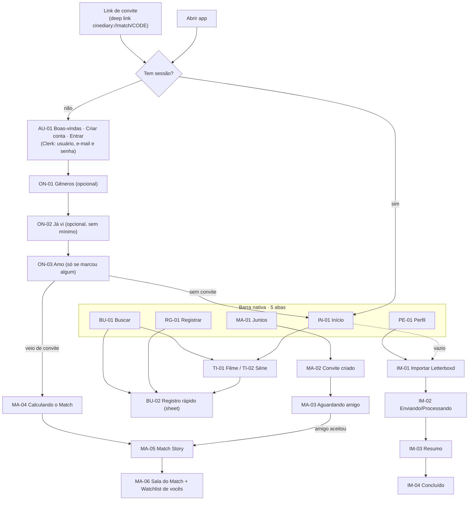

# CineDiary — UX-02 a UX-05 · Fluxos, Telas e Estados do MVP

> **Versão:** 1.1 · **Data:** 13/11/2026 (v1.1: login por usuário/e-mail/senha, sem emoji, abas nativas · v1.2: 5 abas na mesma barra, onboarding sem mínimo, iOS 27) · **Responsável:** Designer UX/UI Senior
> Base: [Mvp Inicial.md](../Mvp%20Inicial.md), [Arquitetura-e-Backlog-MVP.md](../Arquitetura-e-Backlog-MVP.md) e [UX-01-Design-System.md](./UX-01-Design-System.md)
> **Protótipo navegável:** [`prototipo/index.html`](./prototipo/index.html). Abra no navegador; os IDs das telas (ex.: `ON-02`) aparecem no protótipo.
> Títulos, números e nomes nos exemplos são **dados de exemplo**.

---

## 0. Mapa de navegação



**Abas (5, todas na mesma barra nativa: Liquid Glass no iOS 27 e Material 3 no Android; veja a seção 7.1 do UX-01):** Início · Buscar · Registrar · Juntos · Perfil (em inglês, conforme o idioma do aparelho: Home · Search · Log · Together · Profile). A busca é uma aba comum, sem lupa separada. Não usamos FAB: o registro tem a própria aba (RG-01) e também nasce da Busca e da página do título, sempre em ≤ 3 toques.

---

## UX-02 · Conta e Onboarding Cinematográfico (≤ 3 telas, < 1 min)

### AU-01 · Boas-vindas, Criar conta e Entrar (v1.1: sem SSO)
**Decisão do produto:** o login é só por **usuário, e-mail e senha**. Não há Apple, Google nem verificação de e-mail no MVP.

- **AU-01a · Boas-vindas:** mosaico de pôsteres levemente girados no topo, título "Seu diário de *filmes e séries*." e subtítulo "Registre o que viu, traga seu Letterboxd e descubra o quanto você combina com seus amigos." Botões: [Criar conta] (primário) e [Já tenho conta] (secundário).
- **AU-01b · Criar conta** (uma tela só, teclado já aberto):
  - **Nome de usuário**: prefixo "@" fixo dentro do campo, só letras minúsculas, números, "." e "_", sem espaço. Mostra a dica "Você pode mudar depois no perfil".
  - **E-mail**: teclado de e-mail, `autoComplete="email"`.
  - **Senha**: botão de olho para mostrar ou ocultar, `textContentType="newPassword"` (o iOS sugere uma senha forte). Abaixo do campo, a regra mínima do Clerk aparece como texto e não como erro.
  - CTA "Criar conta". Depois dele, vai direto para ON-01, sem tela de "confirme seu e-mail".
- **AU-01c · Entrar:** "E-mail ou usuário" + Senha + CTA "Entrar". O link "Esqueci minha senha" **não entra no MVP**, porque sem e-mail verificado não há como recuperar a conta com segurança. Veja o risco no fim do documento.
- **Validação na tela (só formato, sem verificação de e-mail):** a mensagem aparece ao sair do campo, nunca enquanto a pessoa digita. Exemplos: "Esse @ já está em uso. Que tal *edu.cine*?", "Confira o e-mail: falta o @ ou o domínio." e "E-mail ou senha não conferem."
- **Variante de convite:** quando a pessoa chega por um link, AU-01a troca o título por dois avatares sobrepostos e "**Ana** te chamou para um *Taste Match*" e abre direto em **Criar conta**. O convite fica salvo localmente (SecureStore).
- **Rodapé:** "Ao continuar, você aceita os Termos e a Política de Privacidade" (links).
- Gerenciadores de senha: os campos usam `textContentType` e `autoComplete` corretos, para o iCloud Keychain e o Google Password Manager preencherem e salvarem.

### Barra comum do onboarding
Mostra o progresso em 3 segmentos. **Nada é obrigatório (v1.2):** o CTA está sempre habilitado. Com nada escolhido, ele vira "Pular por agora"; com algo escolhido, "Continuar". O botão voltar preserva as seleções. Se a pessoa não marcar nenhum filme no ON-02, o ON-03 é pulado (não há o que favoritar). Meta de tempo: ON-01 em 10s, ON-02 em 35s e ON-03 em 10s, ou menos de 5s para quem pular tudo.

### ON-01 · "Do que você *gosta*?" (gêneros)
- Chips só com texto, em ordem de popularidade BR: Comédia, Drama, Terror, Ação, Romance, Ficção científica, Animação, Suspense, Aventura, Fantasia, Crime, Documentário, Família, Mistério, Musical, Guerra, Faroeste, História. A lista vem de `GET /api/v1/catalog/genres`.
- **Regra (v1.2):** opcional, sem mínimo nem máximo. Legenda sob o CTA: "Isso ajuda a montar seu Match. Dá para mudar depois no perfil."
- **Dados:** grava em `user_genre_preferences` (source `ONBOARDING`) no envio final.

### ON-02 · "Quais destes você *já viu*?" (opcional, sem mínimo)
- Grade de 4 colunas com **40 pôsteres** (sm), carregada a partir dos gêneros de ON-01. A mistura é de 60% populares no BR e 40% clássicos globais, incluindo filmes nacionais (ex.: *Ainda Estou Aqui*, *Cidade de Deus*, *O Auto da Compadecida*). A curadoria da lista é do backend: *proposta de endpoint `GET /api/v1/onboarding/titles?genres=`*.
- **Interação:** 1 toque seleciona (borda terracota + ícone de check + haptic), outro toque desmarca. Há busca no topo ("Não achou? Busque um título") e "Mostrar outros" no fim da grade.
- **Rodapé fixo:**
  - Contador simples, sem meta e sem barra de "faltam": "**7** marcados". Com 0: "Pode seguir sem marcar nenhum." A partir de 1: "Quanto mais, melhor seu Match."
  - Checkbox **desmarcado por padrão**: "Adicionar estes filmes ao meu diário". Logo abaixo, a explicação: "Se ficar desmarcado, usamos só para entender seu gosto. Seu diário continua vazio."
  - CTA sempre habilitado: "Pular por agora" (0 marcados) ou "Continuar".
- **Dados:** marcados viram `ONBOARDING_SEEN`. Com o checkbox ligado, `addToHistory=true` também cria `user_title_states.watched` **sem data e sem `diary_entry`**. Se a regra do BE-04 exigir um `diary_entry`, use `watched_date = null` e o rótulo "Sem data" no diário: *alinhar com o Backend*.

### ON-03 · "E quais você *ama*?" (favoritos, opcional)
- Mostra **somente os títulos marcados no ON-02** em uma grade maior (md), com coração no canto. Dá para escolher até 4, que também viram os favoritos do perfil.
- CTA "Concluir" (ou "Ver nosso Match" quando há convite). "Pular" no topo.
- **Dados:** `ONBOARDING_FAVORITE` (alimenta os 20% de afeto do Match). Envia tudo em `POST /api/v1/me/onboarding`.
- **Pós-onboarding sem convite:** abre IN-01 com um toast "Bem-vindo(a)! Seu diário está pronto." e o card de importação do Letterboxd em destaque.

**Eventos PostHog:** `user_signed_up` (AU-01b) e `onboarding_completed` com as propriedades do ADR (seção 2): `genres_count`, `titles_selected_count`, `added_to_history`, `duration_seconds`. Para o funil do convite, sugiro somar `from_invite` (boolean) e `favorites_count`: *o Architect decide*.

---

## UX-03 · Busca, Registro em ≤ 3 toques e Séries

### IN-01 · Início (aba 1)
- **Cabeçalho:** "Boa noite, Edu" (varia com a hora).
- **"Juntos agora"** (só aparece com Match ativo): uma linha com a novidade mais recente, por exemplo "Ana salvou *Aquarius* na lista de vocês" ou "Seu Match com Ana subiu para *81%*". Tocar abre MA-06.
- **"Continue assistindo"** (séries com status `WATCHING`): carrossel de cards com pôster, "T2 · E7 — *Nome do ep.*" e botão circular **"+1 ep"**, que marca o próximo episódio com haptic e um toast com "Desfazer".
- **Seu diário:** linha do tempo agrupada por mês ("NOVEMBRO 2026"), com linhas de dia (número do dia em Fraunces), pôster xs, título, estrelas mini, coração e selo "rever" quando é rewatch. Tocar abre TI-01/02; deslizar para a esquerda mostra "Editar" e "Apagar".
- **Vazio:** ilustração de ingresso, "Seu diário está *em branco*", texto "Registre o último filme que você viu, ou traga tudo do Letterboxd em 1 minuto." e os botões [Registrar] (vai para RG-01) e [Importar do Letterboxd].

### RG-01 · Registrar (aba 3, "Log" em inglês)
O lugar de registrar: tudo aqui leva ao registro rápido (BU-02).
- **Título:** "O que você viu *hoje*?" e um campo "Buscar título para registrar" (ao tocar, abre a busca no modo registro: tocar num resultado já abre o sheet).
- **Atalhos em carrossel (1 toque abre o sheet):** "Da sua watchlist" · "Continue assistindo" (episódio seguinte) · "Em alta agora".
- **Regra dos 3 toques a partir desta aba:** pôster → estrela → "Registrar".
- **Vazio** (sem watchlist e sem séries): só o campo e "Em alta agora".
- Ícones da aba: `plus.circle` (iOS) e `add_circle` (Android). Não é um botão destacado nem flutuante: é uma aba igual às outras.

### BU-01 · Buscar (aba 2)
- Input com foco automático e debounce de 300ms. Segmento `Tudo · Filmes · Séries`.
- **Antes de digitar:** "Buscas recentes" e "Em alta no Brasil".
- **Resultado (linha):** pôster xs, título em PT-BR, título original em caption quando for diferente, ano · Filme/Série, selos de estado (ícones Phosphor: check, coração, estrela com nota, marcador) e, à direita, **botão "+" de 44pt**.
- **Estados:** skeleton com 6 linhas; sem resultado: "Não achamos esse título. Tente o nome original ou o ano."; offline: "Sem internet. Mostrando o que já está salvo."

### BU-02 · Registro rápido (bottom sheet): a regra dos 3 toques
```
Toque 1: "+" no resultado         → abre o sheet já com "Assistido hoje" pré-selecionado
Toque 2: estrela (ou ♥)           → define a nota (meia estrela tocando na metade esquerda)
Toque 3: "Registrar"              → salva, haptic de sucesso, sheet fecha e toast "Registrado no seu diário ✓  Desfazer"
```
- **Layout do sheet (altura de ~60%):** pôster sm + título/ano · fila de 3 ações independentes **[Assistido] [Curtir] [Watchlist]** (ícones Phosphor `Check`, `Heart`, `BookmarkSimple`) · StarRating de 32pt · linha "Hoje ›" (ícone `CalendarBlank`) (abre o seletor de data; atalhos Hoje / Ontem / Escolher) · toggle "Já vi antes (rever)" (ícone `ArrowCounterClockwise`), que aparece ligado automaticamente se já houver registro · campo recolhido "Escrever review (opcional)" (ícone `PencilSimple`) · CTA "Registrar".
- **Independência das ações (requisito do MVP):**
  - Sem "Assistido", o CTA vira "Salvar", grava apenas o estado (`PUT /titles/{id}/state`) e não cria entrada no diário.
  - Só "Watchlist": o CTA vira "Salvar na watchlist".
  - Dar nota não exige review, e curtir não exige nota.
- **Série no sheet:** a fila troca "Assistido" por "**Status**" (Assistindo · Concluída · Abandonada), a nota é da série inteira e há o link "Marcar episódios ›" para TI-02.
- **Erro ao salvar:** a UI otimista é revertida e aparece o toast "Não deu para salvar agora. Tentar de novo".

### TI-01 · Página do filme
Backdrop com degradê para creme, pôster lg, título em Fraunces, ano · duração · gêneros e sinopse (3 linhas + "mais"). Depois vem a mesma fila de ações do sheet, a seção "Seus registros" (cada rewatch com data e nota) e o CTA "Registrar de novo". Abaixo, o crédito do TMDB, obrigatório pelos termos.

### TI-02 · Página da série (progresso)
- **Topo:** igual ao TI-01 + chip de status + nota da série.
- **Progresso geral:** ProgressBar "**23** de 62 episódios · 37%" + "Próximo: T3 · E1".
- **Temporadas (acordeão):** cabeçalho "Temporada 2 · 6/10" com mini barra e um **check circular que marca a temporada inteira** (pede confirmação quando a ação desmarcaria episódios já vistos).
- **Episódios:** número, título, duração e data de exibição, mais um checkbox circular. A sinopse fica **oculta por padrão** (proteção contra spoiler; toque para ver). A pressão longa abre "Marcar até aqui", que marca todos os anteriores, também da temporada anterior. Episódios ainda não lançados ficam desabilitados com a data.
- **Automação:** ao marcar o último episódio disponível, aparece o sheet "Terminou *Nome da série*? Dê uma nota" com as estrelas, já com status `COMPLETED`.
- **Abandonar:** menu "⋯" → "Abandonar série", que mantém o progresso e muda o status para `DROPPED`.

**Eventos PostHog:** `title_logged` com as propriedades do ADR (seção 2), incluindo `touch_count`.

---

## UX-04 · Importação do Letterboxd

**Entradas:** card no Diário vazio, card após o onboarding e Perfil → "Importar do Letterboxd".

### IM-01 · Instruções e seleção do ZIP
- Título: "Traga seu *Letterboxd*". Subtítulo: "Seu histórico, notas, curtidas, reviews e watchlist. Leva cerca de 1 minuto."
- **Passo a passo numerado:**
  1. Abra o Letterboxd no navegador e vá em **Settings → Data → Export your data** (botão "Abrir Letterboxd" abre `https://letterboxd.com/settings/data/` no navegador do sistema; *confirmar o caminho atual na Fase 0*).
  2. Baixe o arquivo **.zip** (não precisa descompactar).
  3. Volte aqui e toque em **Escolher arquivo**.
- CTA primário "Escolher arquivo .zip" (`expo-document-picker`, tipo `application/zip`).
- **Nota de confiança:** "Usamos só o arquivo que você enviar. Nunca pedimos sua senha do Letterboxd." (ícone `LockSimple`)
- **Erros de validação (no cliente, antes do envio):**
  - Não é um ZIP: "Esse arquivo não é um .zip do Letterboxd."
  - Acima do limite: "Arquivo grande demais (máx. 50 MB)." (*limite a confirmar com BE-06*)

### IM-02 · Enviando → Processando (assíncrono)
- **Enviando:** barra de upload real (%) e "Enviando seu arquivo…".
- **Processando** (`status=PARSING`, polling de `GET /imports/{jobId}` a cada 2s): ilustração de rolo de filme girando, contador vivo "Encontramos **412** de ~1.000 títulos…" e a mensagem "Você pode sair desta tela; avisamos no Diário quando terminar."
- Se a pessoa sair, um **banner persistente** no topo do Diário mostra "Importando seu Letterboxd… 62%" e, quando termina, "Sua importação está pronta para revisar →". O MVP não tem push.
- **Falha** (`FAILED`): "Algo saiu do roteiro ao ler seu arquivo." + [Tentar de novo] + "Ver detalhes" (código do erro para suporte).

### IM-03 · Resumo antes de confirmar (`AWAITING_CONFIRMATION`)
- Título: "Encontramos *842 filmes*"
- **Cards de contagem:** Assistidos 842 · Notas 790 · Curtidas 211 · Reviews 37 · Watchlist 64 · Registros de diário 905.
- **Já estavam no CineDiary:** "18 já estavam no seu diário e **não serão duplicados**."
- **Não encontrados:** "**12** não encontramos no catálogo" (acordeão com título e ano do CSV). No MVP, eles não são importados; a revisão manual fica para depois.
- Prévia: carrossel com os 10 primeiros pôsteres encontrados.
- **CTA primário:** "Importar para meu diário". Secundário: "Cancelar".

### IM-04 · Aplicando → Concluído
- `APPLYING` mostra uma barra de progresso. Em `COMPLETED`: confete discreto (respeita Reduzir movimento), "Pronto! Seu diário agora tem *842 filmes*." e os CTAs [Ver meu diário] [Criar um Taste Match].
- **Reimportar o mesmo arquivo:** o resumo mostra "Tudo já estava aqui; nada novo para importar" e o CTA vira "Ok".

**Eventos PostHog:** `import_started` `{file_size_kb}`, `import_completed` `{total_read, matched, unmatched, duplicates, duration_ms}` e `import_failed` `{error_code}`.

---

## UX-05 · Taste Match, Match Story 9:16 e Watchlist de vocês

### MA-01 · Juntos (aba 4, "Together" em inglês)
- **Vazio:** ilustração de dois baldes de pipoca, "Quanto você *combina* com seus amigos?", texto "Crie um Match, mande o link e descubra em Stories." e [Criar Match].
- **Lista:** cards com os avatares sobrepostos, "Você + Ana", a porcentagem em Fraunces e a data. Os pendentes ficam com fundo pontilhado e o selo "Aguardando".
- **Pouco ou nenhum dado (v1.2: não há mínimo):** o Match é sempre criado e calculado com o que existir. Menos de 3 títulos em comum ativa o Modo Descoberta, que já existe. Se uma das pessoas não tem nenhum sinal (sem gêneros, filmes, notas nem favoritos), o card mostra "Match *em construção*: registre alguns filmes para ver o resultado", com o botão [Registrar], em vez de uma porcentagem sem sentido. Não há bloqueio nem número mínimo. O Story não muda.

### MA-02 · Convite criado
- Cartão de preview do link (o que o amigo verá): "Edu quer saber o quanto vocês combinam no cinema".
- Ações: [Compartilhar convite] (share sheet nativo: WhatsApp, Instagram DM…) e [Copiar link]. Mensagem pronta: "Bora ver o quanto a gente combina em filmes? {link}".

### MA-03 · Aguardando seu amigo
Card bloqueado com "Aguardando seu amigo *topar*", texto "Assim que a pessoa entrar e escolher alguns filmes, o Match começa sozinho." e [Reenviar convite] · [Cancelar convite]. Quando o status muda para `ACTIVE`, aparecem um badge na aba Match e o banner "Ana topou! Seu Match está pronto →".

### MA-04 · Calculando
Tela de transição de 1,5 a 3s (mínimo de 1,5s para dar expectativa): dois pôsteres favoritos, um de cada, se aproximam e um contador gira. Texto: "Comparando *notas*, *gêneros* e *favoritos*…".

### MA-05 · Match Story (estilo Samokat)
**Controles:** barras de progresso segmentadas no topo, toque na direita avança, toque na esquerda volta, pressão longa pausa, X fecha (com "Ver depois" salvo) e botão fixo **"Compartilhar este"** no rodapé. Cada slide dura 6s. Com Reduzir movimento, os slides não avançam sozinhos.

| # | Slide | Fundo / forma | Conteúdo | Origem no `breakdown_json` |
| --- | --- | --- | --- | --- |
| 1 | **Abertura** | plum + blob blush | Avatares grandes · "Edu *&* Ana" · "Vamos ver o quanto vocês são cinema juntos?" | `users` |
| 2 | **A porcentagem** | butter + estrela tomato | "Vocês são" · **78%** (conta de 0 a 78) · "*cinema juntos*" · selo de nível ("Dupla de sessão dupla") | `score`, `level` |
| 3 | **De onde veio o número** | cream + barras | 3 barras empilhadas: **Notas parecidas** 41 de 50 · **Gêneros em comum** 24 de 30 · **Favoritos** 13 de 20 = 78. Legenda: "Vocês deram notas parecidas em 23 filmes." | `components.ratings/genres/affinity` |
| 4 | **Gêneros** | sage + flor | "Vocês dois vivem de *Drama* e *Terror*", com chips grandes e uma bolha de % por gênero | `sharedGenres[]` |
| 5 | **Vocês dois amam** | blush + arco | 3 a 5 pôsteres girados com as duas notas ★★★★★ / ★★★★½ | `bothLove[]` |
| 6 | **Onde discordam** | tomato + raio | Pôster + "Edu: ★★★★★ · Ana: ★½" · "Esse filme rende *uma boa discussão*." | `disagreements[]` |
| 7 | **Para verem juntos** | ink + estrelas butter | 3 recomendações (títulos que um ama e o outro não viu, ou da watchlist de ambos) + botão "Salvar na watchlist de vocês" (não aparece na imagem exportada) | `recommendations[]` |
| 8 | **Encerramento** | butter | "Edu + Ana = *78%*" · [Compartilhar tudo] · [Ir para a sala de vocês] | — |

**Modo Descoberta (`discovery_mode = true`, menos de 3 títulos em comum):**
- O slide 3 mostra apenas **Gêneros 65% + Favoritos e sinais 35%**, com a legenda honesta: "Vocês ainda viram poucos filmes em comum, então olhamos para o gosto de cada um."
- Os slides 5 e 6 são substituídos por **"Vocês têm muito a *apresentar* um ao outro"**, em duas colunas: "Edu ama e Ana não viu" | "Ana ama e Edu não viu" (3 pôsteres cada).
- O selo do slide 2 vira "Match em *descoberta*: fica mais preciso conforme vocês registram."

**Níveis (texto do selo, divertido e não científico):** 0–39 "Gostos *opostos*, debates garantidos" · 40–59 "Dá pra *negociar* o filme" · 60–79 "Dupla de *sessão dupla*" · 80–100 "Almas *gêmeas* do cinema".

**Exportação 9:16 (PNG 1080×1920):**
- Renderiza um "template de exportação" fora da tela com `react-native-view-shot` e compartilha com `expo-sharing`.
- O template **remove** barras de progresso, X e botões. Ele **adiciona** a logo "cine*diary*" no rodapé e "Faça o seu Match no CineDiary" (*URL/domínio a definir*).
- Zonas seguras: 220px no topo e 280px na base, sem texto (área de UI de Instagram e WhatsApp).
- Pôsteres na imagem exportada levam o crédito "Imagens: TMDB" em caption de 20px.

**Eventos PostHog:** `match_created`, `match_invite_accepted`, `match_story_viewed` `{slide_index, discovery_mode}` e `match_story_shared` `{slide_index, target}`.

### MA-06 · Sala do Match
- Cabeçalho: avatares, porcentagem, "Atualizado hoje" (é recalculado quando alguém registra) e [▶ Rever Story].
- Segmento: **Watchlist de vocês** | **Resumo**.
- **Watchlist de vocês:** grade de pôsteres com o mini-avatar de quem adicionou. Ações: "+ Adicionar" (abre a Busca no modo "adicionar à watchlist de vocês"), pressão longa → "Remover" e "Vimos juntos ✓" (abre o registro rápido; *"vimos juntos" como sinal é pós-MVP: no MVP só registra no diário de quem tocou*).
- **Vazio:** "Nada na lista de vocês ainda. Que tal começar pelas recomendações do Story?" com as 3 recomendações e o botão "+".
- **Resumo:** os mesmos dados dos slides 3 a 6 em formato de lista (acessível e sem animação).

### Proposta de `breakdown_json` para BE-07 (para alinhar)
```json
{
  "score": 78,
  "level": "SESSAO_DUPLA",
  "discoveryMode": false,
  "commonRatedCount": 23,
  "components": {
    "ratings":  { "weight": 50, "points": 41, "basis": 23 },
    "genres":   { "weight": 30, "points": 24, "basis": ["DRAMA", "HORROR", "THRILLER"] },
    "affinity": { "weight": 20, "points": 13, "basis": 6 }
  },
  "sharedGenres": [{ "tmdbGenreId": 18, "name": "Drama", "share": 0.42 }],
  "bothLove": [{ "titleId": 1, "ratingA": 5.0, "ratingB": 4.5 }],
  "disagreements": [{ "titleId": 2, "ratingA": 5.0, "ratingB": 1.5 }],
  "discovery": { "aLovesBNotSeen": [3, 4, 5], "bLovesANotSeen": [6, 7, 8] },
  "recommendations": [{ "titleId": 9, "reason": "A_LOVES_B_NOT_SEEN" }]
}
```

---

## PE-01 · Perfil e estatísticas (aba 5, apoio a FE-05)
Avatar, nome, @ e cadeado quando o perfil é privado · 4 favoritos · 3 cards (Filmes **842**, Séries **31**, Nota média **3,6★**) · "Gêneros que você *mais vê*" (barras horizontais em sálvia, top 5) · "Filmes por mês" (barras verticais dos últimos 12 meses em terracota500, com valor no topo para acessibilidade) · Últimos registros · Configurações: Perfil público/privado (com explicação "Privado: só você vê seu diário. Matches continuam funcionando."), Importar do Letterboxd e Sair.

---

## Checklist de aceite do design por bloco do MVP

| Critério do MVP | Onde está resolvido |
| --- | --- |
| Onboarding ≤ 3 telas e < 1 min, sem nada obrigatório | ON-01/02/03 com "Pular por agora"; metas de 10s, 35s e 10s |
| Checkbox "adicionar ao histórico" desmarcado | ON-02, rodapé |
| Registrar filme em ≤ 3 toques a partir da busca | BU-02 (+ → ★ → Registrar) e RG-01 (pôster → ★ → Registrar) |
| Ações independentes | BU-02, CTA dinâmico |
| Rewatch com datas diferentes | BU-02 toggle "rever" + TI-01 "Seus registros" |
| Séries: episódio, temporada, progresso, concluída/abandonada | TI-02 |
| Resumo da importação antes de confirmar | IM-03 |
| Reimportação não duplica (comunicado) | IM-03 "já estavam" + estado de reimportação |
| "Aguardando seu amigo" | MA-03 |
| Convidado sem conta → onboarding → Match automático | AU-01a (variante) → AU-01b → ON → MA-04 → MA-05 |
| Story: %, gêneros, amam, discordâncias, recomendações | MA-05, slides 2 a 7 |
| Cada tela compartilhável em 9:16 | MA-05, exportação |
| Porcentagem explicável | MA-05, slide 3 + MA-06 Resumo |
| Watchlist compartilhada | MA-06 |
| Perfil público/privado e estatísticas | PE-01 |

## Pontos para alinhar com o time
1. **Backend (BE-04):** onboarding com checkbox marcado deve criar `diary_entry` sem data ou apenas `user_title_states`? A recomendação de UX é **só o estado**, para não poluir a linha do tempo.
2. **Backend (BE-03/04):** endpoint de curadoria dos 40 títulos do ON-02 por gênero.
3. **Backend (BE-06):** limite de tamanho do ZIP e se "não encontrados" serão retornados com título e ano para a lista do IM-03.
4. **Backend (BE-07):** formato do `breakdown_json` acima.
5. **Mobile (FE-02):** login por usuário, e-mail e senha no Clerk (sem SSO e sem verificação), conforme AU-01b/c.
6. **Risco (produto):** sem e-mail verificado não há "esqueci minha senha" seguro, e quem esquecer a senha perde o diário. Sugestão para depois do MVP: ligar a verificação de e-mail só no fluxo de recuperação.
7. **Eventos:** o ADR é a fonte oficial das propriedades do PostHog. Este documento só referencia o ADR.
8. **Decisão revogada (Architect/Backend, v1.2):** caiu o "mínimo de 10 títulos por pessoa". O cálculo do Match precisa aceitar 0 títulos, e o estado "Match em construção" precisa de um sinal na resposta da API (ex.: `insufficientData: true` quando um dos dois não tem nenhum sinal).
9. **i18n (Architect/Mobile, v1.2):** os rótulos das abas seguem o idioma do aparelho (pt ou en). Falta decidir se o resto do app também será traduzido.
